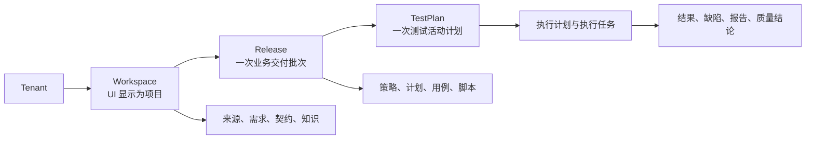
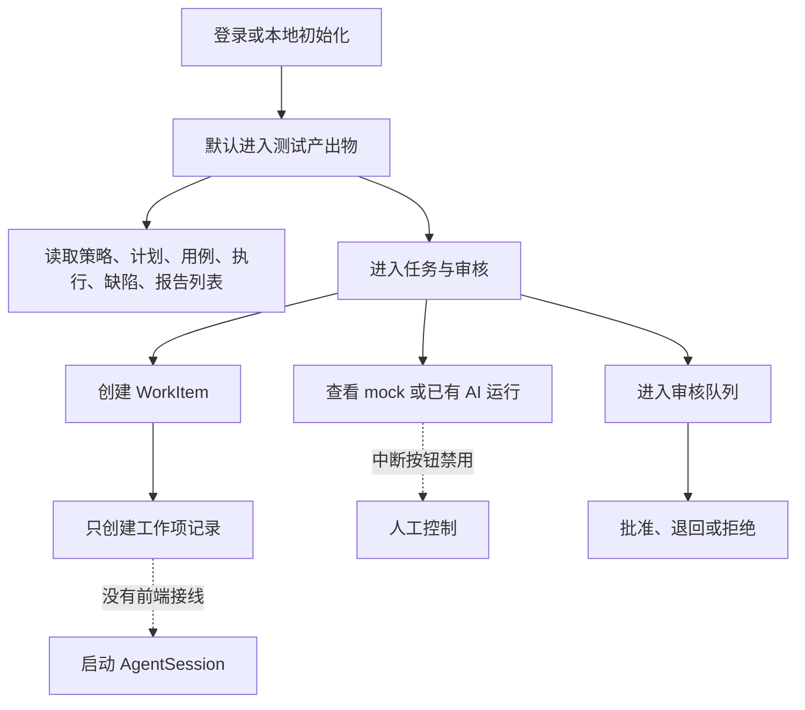
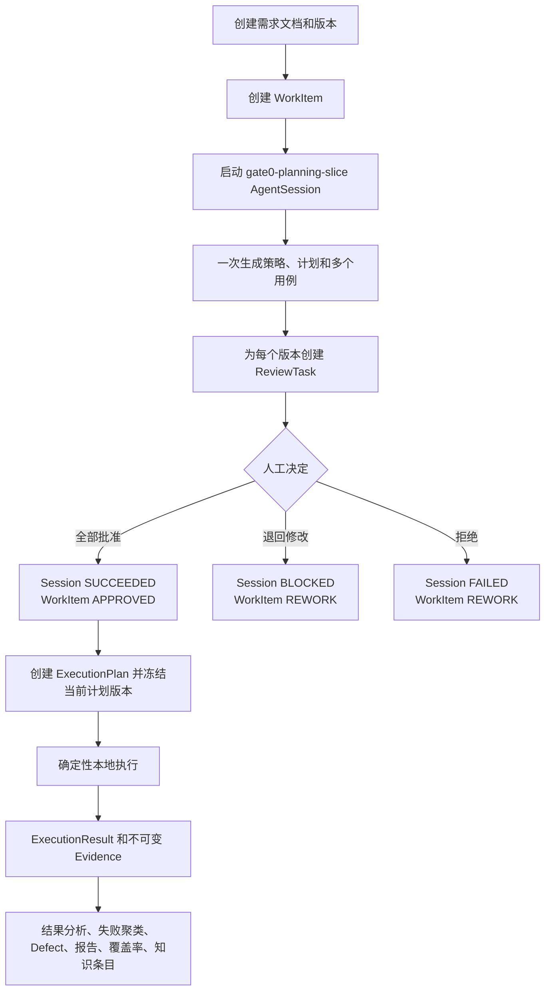
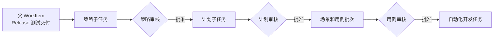
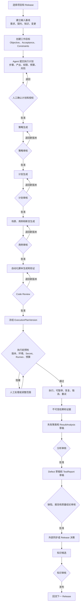
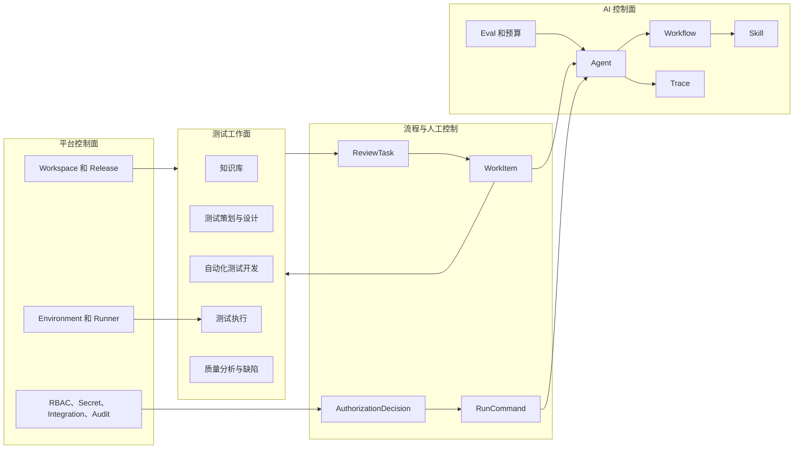

# QualityForge 业务流程与功能关联分析

> 日期：2026-08-27  
> 范围：现行产品文档、前端路由与数据服务、后端 API 与核心工作流  
> 目的：在继续首屏或页面原型设计前，先确认业务主线、功能边界、状态流转和人工控制是否成立
>
> 基线说明：本文保留为“当前实现诊断与裁决前分析”。后续已确认的 57 项产品裁决及目标设计，分别以 [产品业务裁决记录 v1.0](./QualityForge-产品业务裁决记录-v1.0.md) 和 [目标业务流程与功能架构 v1.0](./QualityForge-目标业务流程与功能架构-v1.0.md) 为准；本文中的建议项不得再被视为待裁决状态。

## 1. 结论摘要

QualityForge 的目标方向基本正确：以测试交付物为主线，AI Agent 负责分析、生成和执行，人负责目标、授权、审核和最终质量判断。

当前主要问题不是缺少页面，而是“目标业务模型”和“已实现产品闭环”之间存在断层：

1. 项目和 Release 是全平台上下文，但当前前端切换为演示态，后端虽有目标契约，却没有对应的可用运行时管理闭环。
2. 前端可以创建 WorkItem，但不会继续启动 AgentSession；用户无法从一个业务目标进入 AI 生产流程。
3. 后端规划切片会一次生成策略、计划和多个用例，并一次性创建审核任务，运行时能力存在，但前端没有启动入口和过程控制入口。
4. 执行计划冻结的是 TestPlan 的 `currentVersionId`，未强制要求已批准版本；用例选择也未过滤 `reviewStatus=APPROVED`。这与“正式资产审核后才能执行”的产品规则冲突。
5. Agent 会话没有暂停、继续、中断、取消和授权 API。前端“取消任务”只是本地状态，“中断”按钮明确禁用。
6. 自动化测试开发仍主要是 mock 数据；质量域主要是列表读取，缺少从结果分析到 Defect、报告、门禁和知识回流的用户操作闭环。
7. 当前默认路由是“测试产出物”，它只是跨模块聚合投影，不具备流程所有权，不适合承担平台首要工作入口。

因此，建议暂停进一步视觉原型，先完成 P0 业务闭环裁决和最小纵向链路，再重新定义首页。

## 2. 已确认的产品业务骨架

### 2.1 产品上下文



关键关系：

- Workspace 是数据、权限和持续协作边界，UI 使用“项目”称呼，不应再创建 Project 实体。
- Release 是一次有范围、有时间、有质量结论的业务交付批次。
- TestPlan 是 Release 下的测试活动计划，一个 Release 可以有多个 TestPlan。
- WorkItem 负责流程和责任路由，但不拥有策略、计划、用例、脚本、缺陷和报告正文。
- 正式产出物使用稳定根加不可变版本，审核必须绑定精确版本和摘要。

### 2.2 八个目标功能域

| 功能域 | 业务 Owner | 核心职责 | 主要输出 |
|---|---|---|---|
| 任务看板 | 工作协作域 | 目标、任务、责任人、状态、阻塞、审核路由 | WorkItem、ReviewTask、WorkItemRun |
| 知识库 | 可信输入域 | 来源快照、需求、API 契约、知识版本和溯源 | SourceSnapshot、RequirementDocument、APIContract、KnowledgeEntry |
| 测试策划与设计 | 测试设计域 | 策略、计划、场景、用例、断言与覆盖关系 | TestStrategy、TestPlan、TestCase |
| 自动化测试开发 | 自动化资产域 | Web/API 脚本、代码审核、数据、Locator、Mock | AutomationScript 及配套资产 |
| 测试执行 | 执行域 | 冻结版本、环境预检、调度、结果和证据 | ExecutionPlan、ExecutionTask、ExecutionResult、Evidence |
| 质量分析与缺陷 | 质量域 | 聚类、RCA、Defect、报告、质量门禁 | ResultAnalysis、Defect、TestReport、QualityGate |
| AI Agent 中心 | AI 控制面 | Agent、Skill、Workflow、Prompt、Trace、Eval、预算和降级 | AgentSession、Trace、SkillInvocation、Eval |
| 平台管理 | 平台控制面 | 项目、Release、环境、权限、Secret、集成与审计 | Workspace、Release、Environment、RoleBinding、AuditLog |

## 3. 当前实现的实际流程

### 3.1 前端当前主路径



现状判断：前端具备“看列表、创建任务、审核产物”的若干独立页面，但缺少把这些页面串成同一条业务旅程的控制器。

### 3.2 后端当前纵向切片



该后端切片证明了规划、审核、执行和质量对象可以贯通，但不等于产品已形成可用闭环：前端没有完整驱动它，执行是即时确定性参考运行，部分关键审核约束也没有落实到执行入口。

## 4. 主要业务设计问题

### P0-1 产品运行模式没有最终统一

现行总纲和领域模型面向 TestEngineer、TestLead、WorkspaceAdmin、TenantAdmin 等多人职责；较早产品评估又将产品裁决为“单一测试工程师 + AI”。当前本地认证实际更接近单用户管理员。

风险：审核策略、职责分离、权限模型、首页待办和 Agent 授权都会因为“单人还是团队”产生完全不同的设计。

建议裁决：V1 采用“单 Workspace、小团队协作”，至少保留工程师和负责人两类业务职责；本地单用户模式只作为部署 Profile，不反向删除多人业务语义。四眼审核属于可选策略，不强制所有资产使用。

### P0-2 项目和 Release 只是显示上下文，不是真实工作上下文

已验证现状：

- 顶栏项目切换只显示固定示例项目。
- Release 切换只弹出演示提示。
- 前端新建 WorkItem 在真实模式下临时生成随机 `releaseId`。
- 目标 OpenAPI 已定义 Workspace 和 Release 管理，但当前后端路由未完整实现。

风险：所有“当前 Release 的产出物、进度和质量结论”都可能只是页面拼接，无法证明属于同一业务批次。

建议：先实现 ProjectContext。进入任何业务页都必须从可信上下文获得 `workspaceId + releaseId`，并验证资源归属，禁止页面自行制造 Release ID。

### P0-3 WorkItem 没有成为 AI 协作入口

已验证现状：

- 前端创建 WorkItem 后只停留在列表。
- 前端没有创建 AgentSession 的数据服务或操作入口。
- Agent 中心只能查看 Session，不能从当前 WorkItem 启动、暂停、恢复或停止。

风险：用户看到了“AI 运行中”，但没有清晰的“我给了什么目标、批准了什么范围、AI 为什么开始”的业务证据。

建议：WorkItem 创建必须包含目标、验收标准、约束、Release、输入基线和建议 AgentPlan。人工确认 AgentPlan 后才创建 AgentSession。

### P0-4 Agent 规划粒度过粗

当前 `gate0-planning-slice` 在一个会话中同时生成策略、计划和多个用例。它适合作为技术验证链，但作为产品默认流程存在问题：

- 策略未批准前，计划和用例已经生成，可能基于随后被否决的前提。
- 任一用例审核未完成会阻塞整个 Session 收敛。
- 用户难以只重做一个阶段，也难以单独控制预算和权限。

建议：保留一个父 WorkItem，但将生产链拆成阶段性子任务：



允许策略与计划在明确标记“预览、不形成正式依赖”的情况下并行预生成，但正式下游版本只能引用已批准上游版本。

### P0-5 已批准资产没有成为执行硬前置

已验证现状：

- 创建 ExecutionPlan 时冻结 `TestPlan.currentVersionId`，未检查该版本是否 APPROVED。
- 执行时按 Agent Run 选择用例版本，未过滤 APPROVED，也没有显式冻结 `assetVersionRefs`。
- 后端直接将 ExecutionTask 置为 COMPLETED，无法提供真实运行中的控制窗口。

风险：未经批准或已陈旧的测试计划、用例可以进入执行；结果无法证明对应的精确资产基线。

建议：ExecutionPlanVersion 必须保存并校验：

- approved TestPlanVersionId
- approved TestCaseVersionId 列表
- approved AutomationScriptVersionId 列表
- ReleaseId、EnvironmentId、契约基线和数据配置摘要
- 创建者、批准依据和 frozenBaselineDigest

启动执行前执行 Preflight Gate；任一版本未批准、已陈旧或跨 Workspace/Release 时 fail-closed。

### P0-6 人工接管只存在于界面概念

已验证现状：

- AI 运行页的“中断”按钮禁用，原因是没有后端 interrupt 接口。
- 工作项详情的“取消任务”只改变前端本地状态。
- OpenAPI 目标契约有执行取消，但当前后端未实现。
- 没有 Agent Session 的 pause、resume、cancel、retry、authorize 命令模型。

建议使用统一的运行控制命令，不让页面直接修改状态：

| 命令 | 适用对象 | 关键规则 |
|---|---|---|
| PAUSE | AgentSession、ExecutionTask | 到安全点暂停，返回实际暂停状态 |
| RESUME | 已暂停运行 | 重新验证授权、版本和预算有效性 |
| CANCEL | 未完成运行 | 终止后保留中间产物、Trace 和实际结果 |
| RETRY | 失败节点或失败任务 | 新建 attempt，不覆盖旧记录 |
| AUTHORIZE | 高风险节点 | 明确 scope、有效期、资源、Secret 和预算 |
| REVOKE | 未消费或仍有效授权 | 只追加撤销决定，后续动作 fail-closed |

所有命令返回 CommandReceipt，并追加 AuthorizationDecision、WorkItemEvent 或 AgentTraceNode。

### P0-7 正式产出物的审核覆盖不完整

当前规划切片对策略、计划、用例有审核；DefectVersion 和 TestReportVersion也能创建 ReviewTask。但仍有明显缺口：

- 自动化脚本在前端主要使用 mock 数据，缺少运行时正式版本和 Code Review 闭环。
- ResultAnalysis 创建后只是 DRAFT，没有统一的审核任务创建逻辑。
- KnowledgeEntry 可直接以 ACTIVE 创建，与“知识候选必须审核后发布”的目标规则冲突。
- 报告批准后只更新 currentVersionId，正式签署和 publishedVersionId 尚未闭环。

建议：八类正式产出物统一接入 ArtifactLifecycleService，复用版本、Diff、检查、审核、发布和归档规则，业务模块只拥有正文和专属状态。

### P1-1 “测试产出物”聚合页职责不清

该页面聚合策略、计划、用例、自动化、执行、缺陷和报告，但没有自己的业务实体、状态机或动作权限。它属于 Release 只读投影，不是一级业务模块。

建议：保留但更名为“Release 交付总览”或“产出物库”，作为质量结论的下钻入口；默认入口应由项目态势、我的待办、Agent 运行和风险组成，具体视觉形式要在业务闭环确定后再设计。

## 5. 建议的目标业务流程



## 6. 功能关联设计

### 6.1 工作面与控制面分离



设计原则：

1. 用户围绕业务工作和产出物工作，不围绕 Skill 名称工作。
2. Agent 中心管理能力、版本、权限、运行证据和效果，不拥有测试产出物。
3. WorkItem 负责目标、责任和流程；ReviewTask 负责人工决定；RunCommand 负责运行控制。
4. 首页只读取聚合投影，不直接成为多个领域的可写真相源。

### 6.2 建议新增的三个产品服务

#### ProjectContextService

统一提供当前 Workspace、Release、成员职责、环境和最近更新时间。所有页面、Agent 对话和 API 请求都从这里获得上下文。

#### WorkOrchestrationService

把用户目标转换为父子 WorkItem、AgentPlan、AgentSession、ReviewTask 和 RunCommand，负责状态协调但不保存产出物正文。

#### ReleaseReadinessProjection

从已批准资产、执行事实、未关闭缺陷、报告签署和授权决定构建 Release 只读态势：

- 当前结论及其依据
- 最新变化
- 阻塞和待人处理
- Agent 正在执行的工作
- 版本新鲜度和最后更新时间
- 结论缺失或证据不完整时明确显示 UNKNOWN，而不是自动给出“可发布”

## 7. 首页设计的业务前置条件

只有以下五项得到明确裁决，才建议继续 Stitch 或前端首屏设计：

1. V1 运行模式：推荐“小团队协作，允许单用户部署”，不是把单用户和单一职责混为一谈。
2. 默认业务上下文：推荐必须选 Workspace，Release 可在知识探索场景为空，在交付和执行场景必填。
3. Agent 对话定位：推荐同时支持查询和命令，但命令必须生成可审查 AgentPlan，不能把聊天文本直接当执行授权。
4. WorkItem 粒度：推荐父目标加阶段子任务，不采用一个 Session 一次生成全链所有正式产物。
5. Release 放行规则：推荐由明确的 QualityGatePolicy 计算建议，人类签署最终决定；AI 不能直接批准发布。

## 8. 推荐实施顺序

### P0：先闭合业务地基

1. 实现 Workspace、Release 的真实列表、切换和归属验证。
2. 修复新建 WorkItem 使用随机 Release ID 的问题。
3. 从 WorkItem 启动 AgentPlan 和 AgentSession，并显示输入、范围、权限和预算。
4. 将 Agent 长流程拆为阶段子任务，建立批准上游版本才能进入正式下游的规则。
5. 强制 ExecutionPlanVersion 只冻结已批准的计划、用例和脚本版本。
6. 实现 pause、resume、cancel、retry、authorize、revoke 命令与回执。
7. 补齐 AutomationScript、ResultAnalysis、TestReport、KnowledgeEntry 的版本和审核闭环。

### P1：形成可用的测试交付闭环

1. 完成来源快照和 API 契约导入。
2. 完成自动化代码生成、检查、Code Review 和绑定。
3. 完成真实 Runner 的运行中状态、证据和失败恢复。
4. 完成分析、Defect、报告、外部同步和知识回流的页面操作链。
5. 建立 ReleaseReadinessProjection 和质量门禁建议。

### P2：再做 AI 原生首屏和治理体验

1. 项目态势和待我处理。
2. 绑定当前项目和 Release 的 Agent 对话。
3. AgentPlan 预览、授权和人工接管。
4. Agent、Skill、Workflow、Prompt、Trace、Eval 和成本治理。

## 9. 本次核查的实现覆盖快照

| 项目 | 当前观察 |
|---|---|
| 目标 OpenAPI operationId | 117 |
| 当前后端路由装饰器 | 56 |
| 当前前端 Route | 30 |
| 前端演示、mock、待后端或真实无数据标记 | 47 处 |
| 当前默认路由 | `/artifacts` |
| Agent 启动前端入口 | 未找到 |
| Agent 中断入口 | 按钮存在但禁用 |
| 项目和 Release 切换 | 演示态 |
| 执行已批准版本硬门 | 未落实 |

这些数字用于说明当前实现仍是纵向切片和原型混合体，不能按页面数量判断业务完成度。

## 10. 建议的下一步验收门

继续原型前，先用一个真实但可控的示例 Release 跑通以下验收：

```text
选择项目和 Release
→ 导入一份需求并固化版本
→ 创建一个带目标和验收标准的 WorkItem
→ 查看并批准 AgentPlan
→ Agent 生成策略草稿
→ 人工退回并生成 V2
→ 批准 V2
→ 生成并批准计划、用例和脚本
→ 冻结已批准版本执行
→ 执行中暂停并恢复
→ 产生失败证据
→ 审核分析、Defect 和报告
→ 人工签署 Release 结论
→ 形成待审核知识候选
```

验收证据必须包含每一步的对象 ID、精确版本、摘要、状态事件、人工决定、运行命令回执和跨模块引用。该链跑通后，再设计首页才能保证页面展示的每个数字和动作都有业务真相源。
