# QualityForge 目标业务流程与功能架构 v1.0

> 状态：目标设计基线  
> 日期：2026-08-27  
> 输入：57 项已确认产品裁决、现状业务流程与功能关联分析  
> 范围：业务流程、功能关联、状态模型、Agent 协作和 V1 模块边界；不包含首屏视觉原型

## 1. 目标与边界

### 1.1 产品目标

QualityForge V1 要解决的不是“生成更多测试产物”，而是让一个小型测试团队在 AI 协助下，把项目资料转化为可审核、可执行、可复现、可裁决的测试交付闭环。

### 1.2 V1 成功条件

一个代表性项目能够以真实数据完成：

`资料导入 → 基线确认 → AI 任务计划 → 人工授权 → 策略/计划/用例 → API 自动化 → 真实执行 → 不可变证据 → 质量分析 → 发布裁决 → 知识候选`

最终结论必须能反向追溯到需求依据、正式资产版本、人工决定、运行命令和原始证据。

### 1.3 V1 非目标

- 任意拖拽工作流编排器
- Web UI 自动化完整生产化
- 多租户自助运营、计费和复杂配额
- 复杂设备实验室管理
- Jira、Confluence、网盘等全量连接器
- 普通用户自由安装 Skill 或接入任意工具
- 无人值守地批准正式资产或作出发布裁决

## 2. 核心业务对象与层级

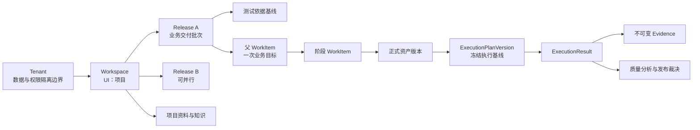

核心语义：

- `Workspace` 是项目、成员、权限和长期资料边界。
- `Release` 是一次可独立裁决的业务交付批次；同项目可并行多个 Release。
- `TestPlan` 是 Release 下的测试活动计划，不等同于 Release。
- `WorkItem` 管理目标、责任和流程，不拥有正式产出物正文。
- 正式资产采用稳定根与不可变版本；`PUBLISHED` 版本才可形成正式依赖。
- 执行计划冻结精确资产、环境、数据和授权摘要，执行结果与证据只追加不覆盖。

## 3. 目标业务流程图

```mermaid
flowchart TD
    A[选择项目] --> B{业务类型}
    B -->|知识探索| C[可不选 Release]
    B -->|交付/执行/质量| D[必须选择 Release]
    C --> E[导入或检索授权资料]
    D --> E
    E --> F[资料分级、版本化与权威标记]
    F --> G{完整性与冲突门禁}
    G -->|资料不足| G1[输出缺口清单\n补充或人工裁决]
    G1 --> G
    G -->|通过| H[创建对话意图或结构化任务卡]
    H --> I[协调 Agent 生成 AgentPlan\n步骤、影响、权限、预算、风险]
    I --> J{人工确认计划与授权}
    J -->|退回| I
    J -->|批准| K[生成测试策略草稿]
    K --> K0[评估 Agent 在线评估]
    K0 --> K1{人工审核}
    K1 -->|退回新版本| K
    K1 -->|发布| L[生成测试计划]
    L --> L0[评估 Agent 在线评估]
    L0 --> L1{人工审核}
    L1 -->|退回新版本| L
    L1 -->|发布| M[生成场景、用例和断言]
    M --> M0[评估 Agent 在线评估]
    M0 --> M1{人工审核}
    M1 -->|退回新版本| M
    M1 -->|发布| N[生成 API 自动化代码]
    N --> N0[静态检查、沙箱验证和评估]
    N0 --> N1{Code Review}
    N1 -->|退回新版本| N
    N1 -->|发布| O[冻结 ExecutionPlanVersion]
    O --> P{Preflight Gate}
    P -->|阻断| P1[修复或申请人工豁免]
    P1 --> P
    P -->|通过| Q[Runner 真实执行]
    Q --> Q1[暂停/继续/取消/重试\n命令回执与检查点]
    Q1 --> R[结果与不可变证据]
    R --> S[失败聚类与质量分析]
    S --> S0[评估 Agent 评估证据和结论]
    S0 --> T{人工审核分析、缺陷和报告}
    T -->|退回| S
    T -->|通过| U[AI 生成发布建议]
    U --> V{测试负责人最终裁决}
    V -->|通过/条件通过/不通过| W[Release 结论与签署记录]
    W --> X[知识候选]
    X --> Y{知识审核}
    Y -->|发布| Z[正式知识并回流后续 Release]
```

### 3.1 流程硬门禁

| 门禁 | 输入 | 阻断条件 | 通过产物 |
|---|---|---|---|
| 资料门禁 | 项目资料目录、权威等级、版本 | 缺关键依据、版本冲突未裁决、资料不可访问 | 测试依据基线 |
| 计划授权门禁 | AgentPlan、权限、预算、风险 | 未确认范围、越权、预算缺失 | 已批准 AgentPlan |
| 正式资产门禁 | 资产版本、评估结果、ReviewTask | 未审核、存在硬阻断、上游不是正式版本 | `PUBLISHED` 资产版本 |
| 执行预检门禁 | 冻结资产、环境、Runner、数据、凭据、预算 | 任一无效、跨项目/Release、已过期 | 可启动 ExecutionPlanVersion |
| 发布门禁 | 覆盖、执行、缺陷、证据、豁免 | 资料不完整、严重阻断未关闭、缺人工签署 | ReleaseDecision |

## 4. 功能关联设计

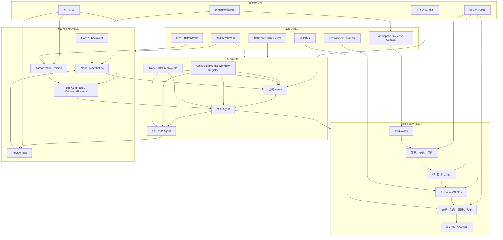

### 4.1 功能归属原则

1. 首页是只读态势与工作入口，不成为跨领域可写真相源。
2. WorkItem 负责编排，业务模块拥有各自产物正文和领域规则。
3. ReviewTask 只承载人工决定，不复制业务产物。
4. Agent 中心拥有能力配置与运行治理，不拥有测试资产。
5. “测试资产”是跨域检索投影，不作为一级创建模块。
6. 内部缺陷是闭环真相源，外部缺陷平台是同步目标。

## 5. 核心状态模型

### 5.1 父任务与阶段任务

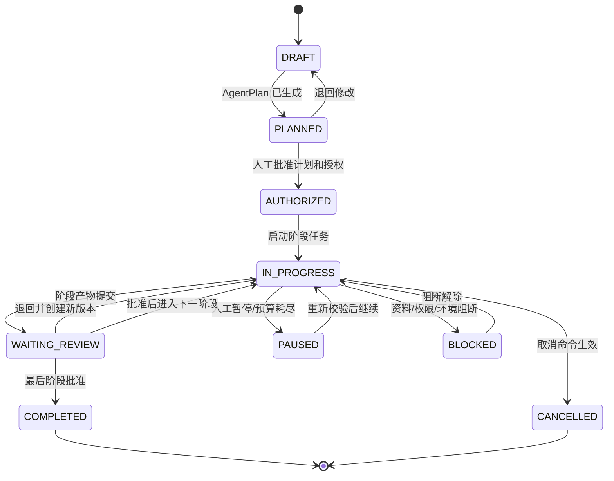

父任务状态由阶段任务聚合，不允许页面手工改写。每个阶段任务有独立预算、审核和检查点。

### 5.2 正式资产生命周期

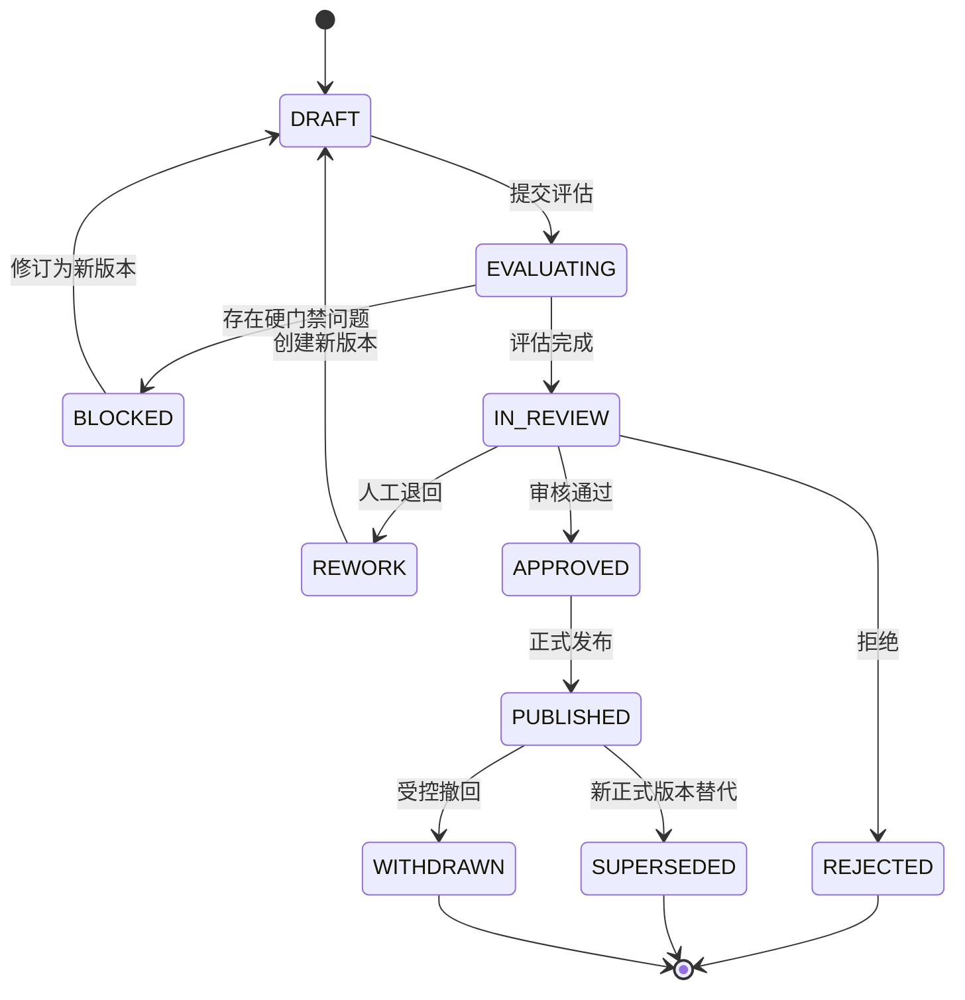

只有 `PUBLISHED` 版本可被正式下游或执行计划引用；历史版本不可覆盖。

### 5.3 Agent Session 与运行命令

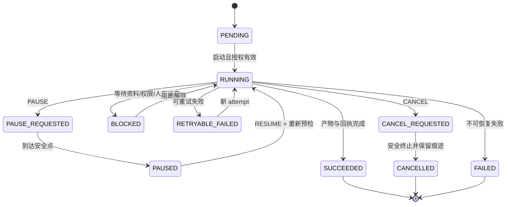

每次 `PAUSE / RESUME / CANCEL / RETRY / AUTHORIZE / REVOKE` 都创建命令和回执，不能仅修改状态字段。

### 5.4 ReviewTask

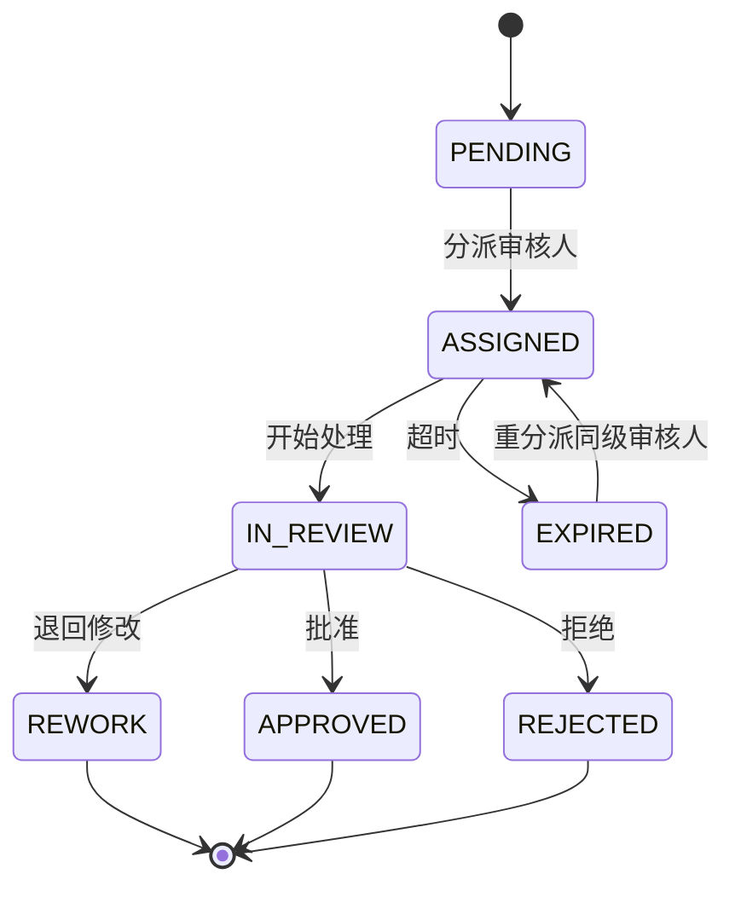

双人复核是审核策略，不应另建一套产物状态机；两位审核人的决定由 ReviewTask 组合规则汇总。

### 5.5 Release 质量状态

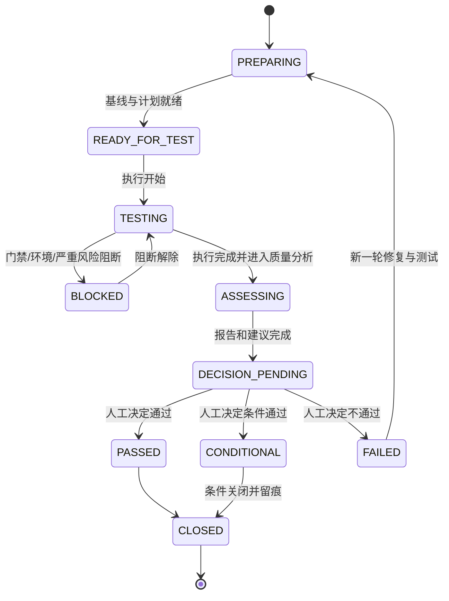

项目整体状态和 Release 状态均由事实聚合；人工只执行有语义的决定或操作。

## 6. Agent 协作设计

### 6.1 Agent 拓扑

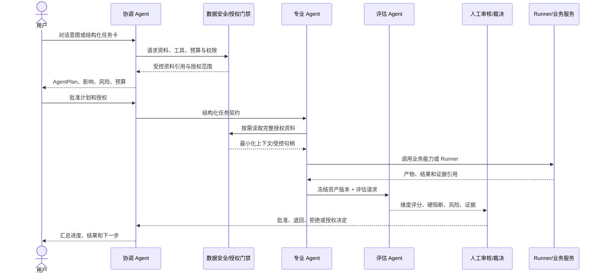

### 6.2 V1 专业 Agent 职责

| Agent | 主要职责 | 允许写入 | 禁止事项 |
|---|---|---|---|
| 协调 Agent | 理解目标、生成计划、拆分任务、汇总状态、路由人工待办 | WorkItem 草案、AgentPlan、任务契约 | 自行批准计划、提高预算、修改评估结果 |
| 资料分析 Agent | 资料目录、分级、完整性、冲突和变更影响 | 基线草案、缺口与冲突清单 | 擅自裁决权威冲突 |
| 测试设计 Agent | 策略、计划、场景、用例和断言 | 对应资产草稿版本 | 发布正式资产 |
| 自动化开发 Agent | API 测试代码、检查和修订 | 隔离工作区/分支、脚本草稿版本 | 修改受保护分支、部署 |
| 执行分析 Agent | 组织执行、失败聚类、结果分析 | 执行请求、分析草稿 | 修改原始证据、绕过 Preflight |
| 缺陷与报告 Agent | 缺陷草稿、报告草稿、发布建议 | 内部缺陷和报告草稿 | 外部写入或最终发布裁决 |
| 评估 Agent | 在线评分、硬门禁、风险、离线回归与漂移监测 | 独立评估记录 | 修改被评对象、批准资产、作发布决定 |

### 6.3 结构化任务契约

每次 Agent 交接至少包含：

- `tenantId / workspaceId / releaseId / workItemId`
- 业务目标、范围、验收标准和约束
- 输入资产 ID、精确版本、摘要与权威级别
- 允许的模型、Skill、工具、数据级别和写入范围
- Token、费用、时长、并发和重试预算
- 预期输出类型、Schema、评估规则版本和人工审核策略
- 超时、失败、升级和取消规则

大资料只传递受控引用，接收 Agent 在授权范围内按需读取；所有交接有发送方、接收方、时间和回执。

## 7. 独立评估 Agent 设计

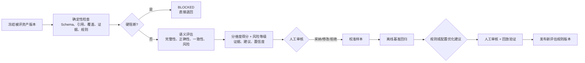

项目总评分不简单平均，建议由以下维度构成：

- 需求与风险覆盖
- 正式资产质量
- 执行完成度与真实结果
- 缺陷风险与关闭情况
- 证据完整性和可复现性
- 门禁、豁免和人工裁决状态

任何严重阻断项都限制总评分上限；资料不足必须同时降低数据完整度与评分置信度。

## 8. V1 模块边界

### 8.1 V1 纵向边界图

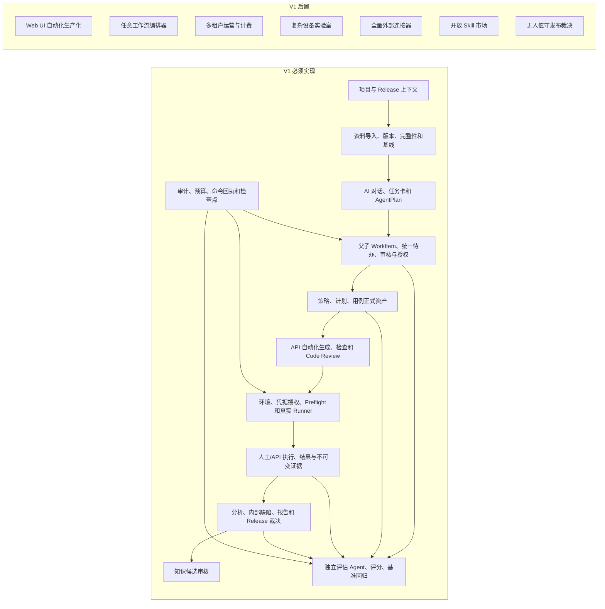

### 8.2 模块职责与真相源

| V1 模块 | 业务 Owner | 写入真相源 | 关键依赖 |
|---|---|---|---|
| 项目上下文 | 平台管理 | Workspace、Release、成员与角色 | Tenant 边界、RBAC |
| 资料与基线 | 可信输入域 | SourceSnapshot、资料版本、Baseline、ConflictDecision | 文件/Git/OpenAPI/Postman 接入、安全门禁 |
| AI 协作与任务 | 工作协作域 | WorkItem、AgentPlan、TaskContract、ReviewTask、AuthorizationDecision | 项目上下文、Agent Registry |
| 测试策划与设计 | 测试设计域 | Strategy、TestPlan、TestCase 及不可变版本 | 已确认基线、评估与审核 |
| 自动化开发 | 自动化资产域 | AutomationScriptVersion、代码审查记录 | 用例正式版本、隔离代码工作区 |
| 测试执行 | 执行域 | ExecutionPlanVersion、ExecutionTask、ExecutionResult、Evidence | Environment、Runner、Secret、Preflight |
| 质量与发布 | 质量域 | ResultAnalysis、Defect、TestReport、QualityGate、ReleaseDecision | 执行事实、正式资产、人工签署 |
| 评估治理 | 独立评估域 | EvaluationRun、RubricVersion、BenchmarkRun、CalibrationSample | 冻结资产、规则、人工反馈 |
| 知识治理 | 知识域 | KnowledgeCandidate、KnowledgeEntryVersion | 已审核结论、来源与时效 |
| 平台治理 | 平台控制面 | Agent/Skill/Prompt/Workflow 版本、环境、授权、审计、预算 | 全域 |

### 8.3 首页与菜单的业务边界

首屏原型后续必须基于以下已确定信息架构，不得提前改变业务归属：

- 默认首页：项目/版本驾驶舱
- 首页核心：AI 对话、项目阶段、风险阻塞、统一待办、最近有效活动、质量评分与置信度
- 一级业务入口：资料与基线、测试策划与设计、自动化开发、测试执行、质量与发布、统一待办
- 管理入口：Agent 中心、平台管理
- 二级只读入口：测试资产统一检索

具体导航数量、布局和视觉层级留到首屏原型阶段裁决。

## 9. 关键只读投影

### ProjectContextProjection

提供当前项目、Release、成员职责、环境授权、常用项目和最近有效更新时间。所有页面与 Agent 请求从该投影获得上下文。

### WorkOrchestrationProjection

汇总父子任务、AgentPlan、阶段、审核、授权、运行命令、阻塞、预算和人工待办，但不复制业务产物正文。

### ReleaseReadinessProjection

从正式资产、执行事实、缺陷、证据、质量门槛、豁免和人工签署计算：

- 当前阶段与完成度
- 主要风险和阻塞
- 资料完整度与结论置信度
- 项目质量评分及维度趋势
- AI 发布建议与人工最终决定
- 最近有效业务更新时间

证据不足时必须输出 `UNKNOWN`，不得用默认值伪装正常。

## 10. V1 端到端验收场景

```text
创建并选择项目与 Release
→ 导入需求、DOCX/PDF、OpenAPI 和 Git 代码并形成版本
→ 识别一处资料缺口和一处冲突，完成补充与人工裁决
→ 通过首页对话创建任务，检查结构化任务卡
→ 审核 AgentPlan、权限与预算
→ 生成策略 V1，评估 Agent 给出阻断，人工退回
→ 生成并发布策略 V2
→ 生成并发布计划、用例和 API 自动化脚本
→ 冻结所有正式版本并完成 Preflight
→ 启动真实 Runner，执行一次暂停与恢复
→ 产生成功和失败结果及不可变证据
→ 生成并审核分析、内部缺陷和测试报告
→ 测试负责人作出 Release 裁决
→ 生成知识候选并完成审核
→ 从 Release 结论反向追溯全部资料、版本、评估、审核、命令和证据
```

### 10.1 验收证据

- 每一步的对象 ID、精确版本、状态事件和摘要
- 人工计划确认、审核、授权、豁免和发布决定
- Agent/模型/Prompt/Skill/规则版本与预算消耗
- RunCommand、CommandReceipt、Checkpoint 和失败重试 attempt
- Runner 原始回执、请求/响应、日志及证据摘要
- 评估维度得分、硬阻断、风险等级、规则版本和人工校准结果
- 正向与反向追溯查询结果

关键链路任何一步仍依赖 mock、无法控制、无法审计或无法反向追溯时，V1 不得判定完成。

## 11. 实施优先级

### P0：业务与控制地基

1. 真实 Workspace/Release 上下文与归属校验。
2. 资料目录、版本、完整性、权威冲突和安全门禁。
3. 结构化任务卡、AgentPlan、父子 WorkItem、统一待办。
4. ReviewTask、AuthorizationDecision、RunCommand/Receipt 和审计。
5. 正式资产版本生命周期与 `PUBLISHED` 执行硬门。

### P1：真实纵向闭环

1. 策略、计划、用例和 API 自动化分阶段生成、评估与审核。
2. 环境、Secret 句柄、Preflight、真实 Runner 和检查点恢复。
3. 人工/API 统一执行结果、不可变证据、分析、缺陷和报告。
4. ReleaseReadinessProjection、质量评分和人工发布裁决。

### P2：治理与体验收口

1. 独立评估 Agent 的离线基准、校准和漂移监测。
2. Agent/Skill/Prompt/Workflow 全版本治理与灰度回滚。
3. 知识候选回流与外部缺陷同步。
4. 基于真实投影设计项目/版本驾驶舱首屏原型。

## 12. 进入首屏原型的准入条件

以下内容至少达到接口和状态契约稳定，才开始首屏原型：

1. 项目、Release、最近有效更新时间和常用项目的真相源明确。
2. 父子任务、阶段、阻塞、人工待办和 Agent 运行状态可统一投影。
3. ReleaseReadinessProjection 字段、`UNKNOWN` 语义和评分口径明确。
4. AI 对话的查询、任务卡、AgentPlan、授权和控制命令契约明确。
5. 测试资产一级/二级导航归属不再变化。
