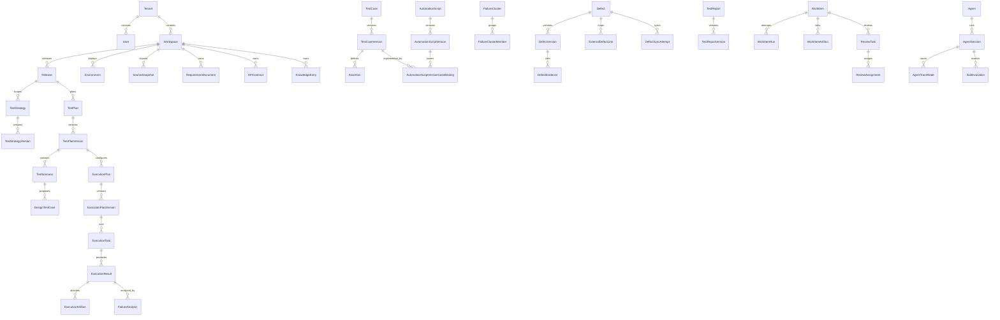
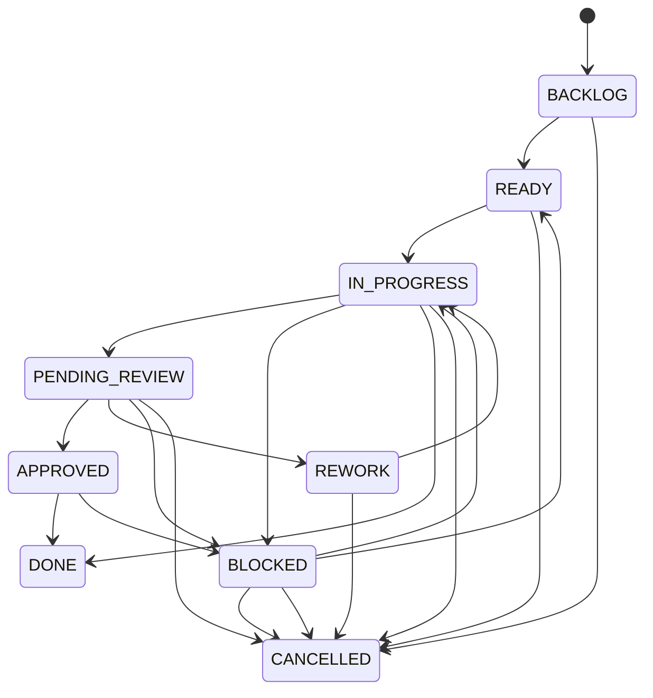
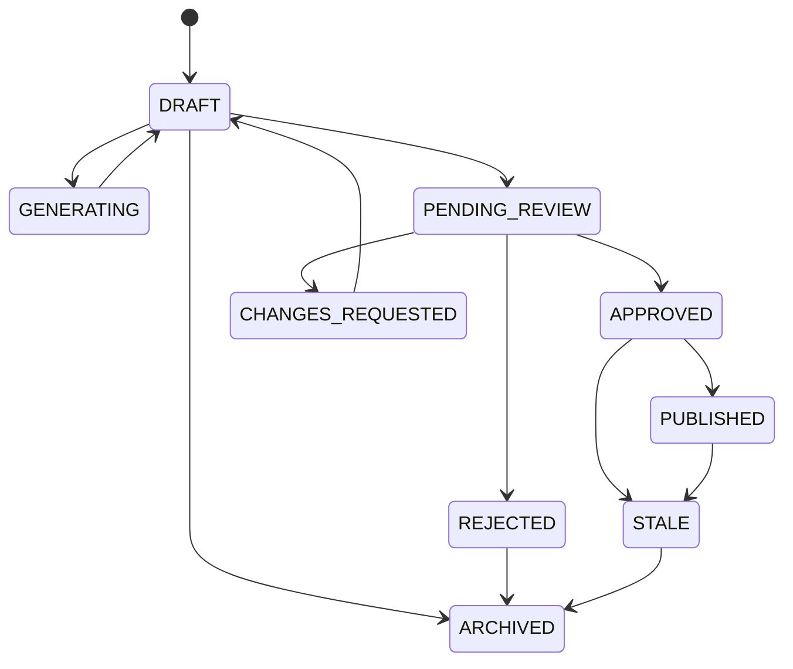
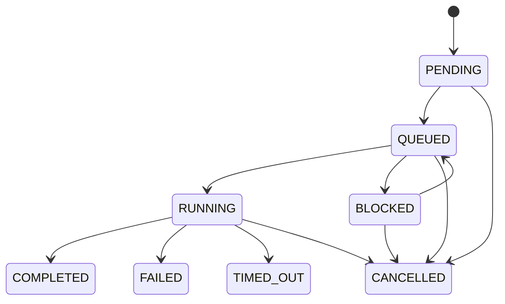
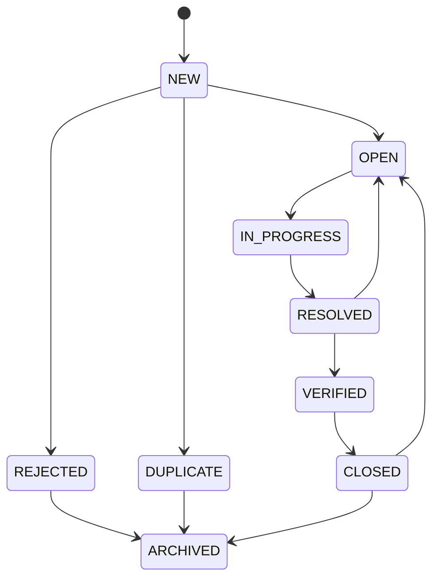
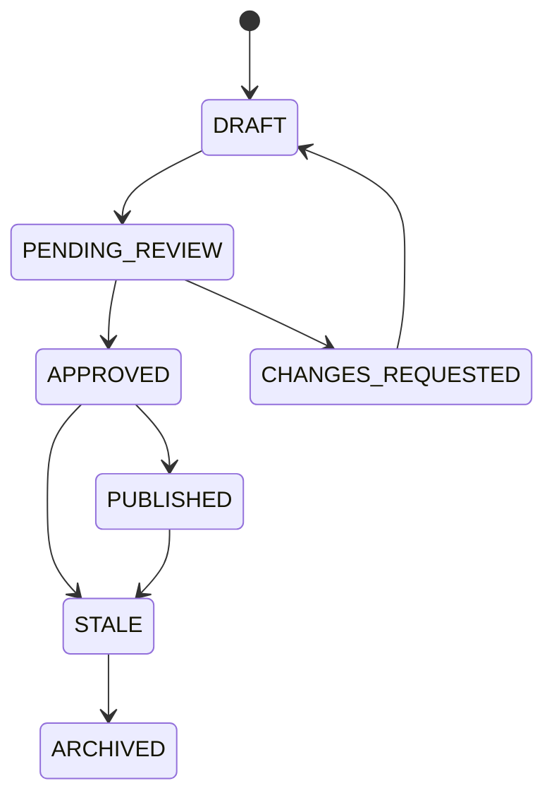
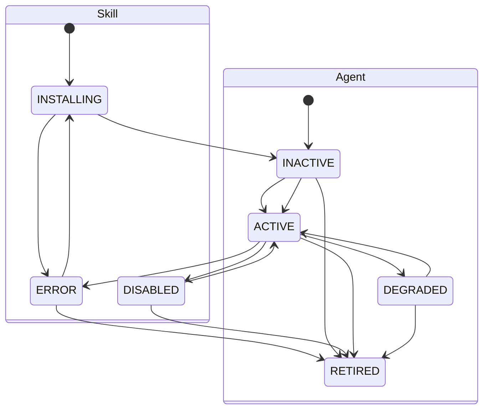

# QualityForge 核心领域模型

> 本文档是QualityForge目标领域实体、关系、关键字段和状态机的权威源。术语以[03-术语表Glossary.md](03-术语表Glossary.md)为准，产品裁决依据[05-功能模块重构方案.md](05-功能模块重构方案.md)。API和DB必须同步本文，不得各自新增同义实体或状态。

## 1. 建模原则

1. 一个实体只有一个业务Owner；其他模块只能引用精确版本、读取投影或调用Owner命令。
2. Workspace是数据和权限边界，产品界面显示“项目”；不新增Project实体。
3. Release表达业务发布；资产`version`表达内容修订，两者不得混用。
4. 正式产出物使用“稳定身份 + 不可变版本”；审核绑定`artifactVersionId + contentDigest`。
5. WorkItem拥有流程，不拥有策略、用例、代码、Defect、报告等正文。
6. ExecutionResult和ExecutionArtifact是不可变事实；分析、Defect和报告不得反向覆盖。
7. Agent/Skill运行证据归AI Agent中心；Agent不能批准正式产出物。
8. 所有高价值状态变化和授权决定只追加事件，不以覆盖当前字段替代审计。
9. 删除默认是归档/废弃；被历史执行、报告、Defect或审计引用的版本不得物理删除。
10. 本项目当前无生产数据；TestDesignPlan、AIContext、BaselineItem等旧对象按迁移表退场，不保留双写模型。

### 1.1 通用标识与字段

除特别说明外：

| 字段                  | 规则                                                  |
| --------------------- | ----------------------------------------------------- |
| `id`                  | UUID；实体或版本的不可复用主键                        |
| `tenantId`            | 租户内对象必填；服务端从可信身份上下文获得            |
| `workspaceId`         | Workspace内对象必填；跨Workspace引用默认拒绝          |
| `createdAt/createdBy` | 创建审计字段；createdBy包含actorType/actorId          |
| `updatedAt`           | 仅稳定聚合根/可变配置使用；不可变版本不更新正文       |
| `version`             | 聚合内从1递增的整数；与Release无关                    |
| `contentDigest`       | 受审核正文、结构化字段和证据集合的规范化摘要          |
| `sourceTrace`         | 使用SourceTraceEdge保存；便捷摘要字段不能替代关系实体 |
| `legacyRef`           | 仅用于历史ID/路径反查，不参与当前业务身份             |

### 1.2 通用正式版本字段

TestStrategyVersion、TestPlanVersion、TestCaseVersion、AutomationScriptVersion、ResultAnalysisVersion、DefectVersion、TestReportVersion和KnowledgeEntryVersion至少包含：

| 字段                            | 规则                                                                                           |
| ------------------------------- | ---------------------------------------------------------------------------------------------- |
| `id`                            | 精确版本ID                                                                                     |
| `<artifact>Id`                  | 稳定聚合根ID                                                                                   |
| `version`                       | 聚合内递增；与父ID联合唯一                                                                     |
| `reviewStatus`                  | `DRAFT/GENERATING/PENDING_REVIEW/CHANGES_REQUESTED/APPROVED/PUBLISHED/REJECTED/STALE/ARCHIVED` |
| `contentDigest`                 | 必填；变化即新版本                                                                             |
| `changeSummary`                 | v2起必填                                                                                       |
| `supersedesVersionId`           | 被替代版本，可空                                                                               |
| `generatedByAgentId/agentRunId` | AI参与时记录                                                                                   |
| `createdBy/createdAt`           | 版本创建审计                                                                                   |

批准人、决定、签名和检查结果以ReviewTask/ReviewAssignment为权威；版本可以缓存`approvedAt`，但不得只靠缓存证明批准。

---

## 2. 全局关系图



跨域多态关系由`WorkItemArtifact`、`DefectEvidence`和`SourceTraceEdge`表达，必须同时保存资源类型、稳定ID、精确版本ID和digest，不能只保存自由字符串ID。

---

## 3. 任务看板域

### 3.1 WorkItem

| 字段                               | 规则                                                                                                                |
| ---------------------------------- | ------------------------------------------------------------------------------------------------------------------- |
| `id/tenantId/workspaceId`          | 必填                                                                                                                |
| `workItemType`                     | `STRATEGY/PLAN/TEST_DESIGN/AUTOMATION_WEB/AUTOMATION_API/EXECUTION/RESULT_ANALYSIS/DEFECT/REPORT/KNOWLEDGE/GENERAL` |
| `title/description`                | 标题必填，描述可空                                                                                                  |
| `objective` | 必填，测试目标而非操作步骤；AI 不得自行扩大 |
| `acceptanceCriteria` | 必填，完成判据；必须由测试人员创建或确认，AI 不得自行扩大顶层目标与授权范围 |
| `constraints` | 可空，约束与限制条件 |
| `agentId` | 可空，当前处理 Agent 引用（若无则为人工处理） |
| `requiresReview` | 必填，是否必须创建审核工单；正式产出默认 true |
| `lockVersion` | 必填，乐观锁版本，防止并发审核覆盖 |
| `status`                           | WorkItem状态机                                                                                                      |
| `currentActorType/currentActorId`  | `HUMAN/AGENT/SERVICE/SYSTEM/NONE`及当前责任主体(与 33 actor_type 四值对齐补 SERVICE,裁决 2026-08-15 B14)                                                                             |
| `priority/riskLevel`               | 优先级及`LOW/MEDIUM/HIGH/CRITICAL`                                                                                  |
| `ownerId/assigneeId`               | 业务Owner和当前人工受理人，可空但状态受约束                                                                         |
| `releaseId/testPlanId`             | 上下文引用，可空；若存在必须同Workspace                                                                             |
| `parentWorkItemId`                 | 可空；禁止跨Workspace和循环                                                                                         |
| `reviewPolicyId`                   | 适用的ReviewPolicy版本                                                                                              |
| `dueAt/slaSeconds`                 | SLA与截止时间                                                                                                       |
| `blockedReasonCode/blockedDetails` | BLOCKED时必填                                                                                                       |
| `createdAt/updatedAt/completedAt`  | 审计时间                                                                                                            |

### 3.2 WorkItem支持实体

| 实体                   | 关键字段                                                                                                                      | 关键约束                                     |
| ---------------------- | ----------------------------------------------------------------------------------------------------------------------------- | -------------------------------------------- |
| **WorkItemArtifact**   | workItemId、artifactType、artifactId、artifactVersionId、contentDigest、relationType                                          | 同一任务/版本/关系唯一；不级联删除业务产出物 |
| **WorkItemRun**        | workItemId、attemptNo、actorType/actorId、agentSessionId、status、inputDigest、outputDigest、startedAt/completedAt、errorCode | `workItemId+attemptNo`唯一；每次重试新记录   |
| **WorkItemEvent**      | workItemId、sequenceNo、eventType、fromStatus、toStatus、actor、reason、occurredAt                                            | 只追加；序号连续                             |
| **WorkItemDependency** | predecessorId、successorId、dependencyType、createdAt                                                                         | 同Workspace；禁止自环和DAG循环               |

### 3.3 ReviewTask与ReviewAssignment

> 裁决 B2-10(2026-08-14):`ReviewDecision` 是 `ReviewAssignment.decision` 与 `AuthorizationDecision` 的只追加投影概念,不建独立实体/表;文档引用 ReviewDecision 处均指该投影。

| ReviewTask字段                              | 规则                                                                                  |
| ------------------------------------------- | ------------------------------------------------------------------------------------- |
| `id/workItemId`                             | 必填；一个WorkItem可有多个审核阶段                                                    |
| `artifactType/artifactId/artifactVersionId` | 必填，绑定精确版本                                                                    |
| `contentDigest/diffRef`                     | 必填；Diff引用可空仅限v1                                                              |
| `policyType/policyVersionId`                | `SINGLE_REVIEW/FOUR_EYES/CODE_REVIEW/EXTERNAL_WRITE/REPORT_SIGNOFF/KNOWLEDGE_PUBLISH` |
| `status`                                    | `OPEN/IN_PROGRESS/APPROVED/CHANGES_REQUESTED/REJECTED/EXPIRED/CANCELLED`              |
| `checkResultsRef`                           | 确定性检查集合                                                                        |
| `createdAt/expiresAt/completedAt`           | 审计时间                                                                              |

| ReviewAssignment字段              | 规则                                                                       |
| --------------------------------- | -------------------------------------------------------------------------- |
| `reviewTaskId/assigneeId`         | 必填；只允许人类User                                                       |
| `reviewRole`                      | `REVIEWER/APPROVER`                                                        |
| `requiredCapability`              | 专属批准能力键                                                             |
| `status`                          | `ASSIGNED/ACCEPTED/APPROVED/CHANGES_REQUESTED/REJECTED/REASSIGNED/EXPIRED` ｜ EXPIRED 为终态;超时行为=新建 ReviewAssignment 并将原 assignment 置 REASSIGNED(裁决 2026-08-15 B2,超时落在任务分派层而非状态跳转) |
| `decision/comments/signature`     | 完成时记录；决议绑定contentDigest                                          |
| `assignedBy/assignedAt/decidedAt` | 审计字段                                                                   |

四眼策略下Reviewer与Approver必须是不同自然人，Approver不能是目标版本最后修改人。Agent永远不能成为ReviewAssignment.assigneeId。

---

## 4. 知识库域

### 4.1 来源、需求与溯源

| 实体                           | 关键字段                                                                                                                                             | 关键约束                                                             |
| ------------------------------ | ---------------------------------------------------------------------------------------------------------------------------------------------------- | -------------------------------------------------------------------- |
| **SourceSnapshot**             | sourceType、sourceIntegrationId、sourceLocator、fetchedRevision、rawContentRef、rawDigest、mediaType、specVersion、fetchStatus、fetchedBy、fetchedAt | 不可变；同内容可标NO_CONTENT_CHANGE但不覆盖旧快照                    |
| **RequirementDocument**        | name、documentType、status、currentVersionId、publishedVersionId                                                                                     | 稳定身份；status=`ACTIVE/ARCHIVED`                                   |
| **RequirementDocumentVersion** | requirementDocumentId、version、sourceSnapshotId、contentRef、contentDigest、parseStatus、reviewStatus                                               | 不可变；parseStatus=`DRAFT/PARSING/COMPLETED/FAILED`；发布需人工审核 |
| **SourceTraceEdge**            | fromType/fromId/fromVersionId/fromDigest、toType/toId/toVersionId/toDigest、relationType、evidenceClass、createdBy、createdAt                        | 只追加；`evidenceClass=CONFIRMED/INFERRED/UNRESOLVED/CONTRADICTS`    |
| **AIContextSnapshot**          | workItemId、sourceVersionRefs、environmentRef、policyRefs、contextRef、contentDigest、createdAt                                                      | 不可变；不得包含Secret明文；不设可编辑当前上下文                     |

### 4.2 APIContract聚合

| 实体                    | 关键字段                                                                                                                                                                                                            | 关键约束                                                                    |
| ----------------------- | ------------------------------------------------------------------------------------------------------------------------------------------------------------------------------------------------------------------- | --------------------------------------------------------------------------- |
| **APIContract**         | name、serviceKey、protocol、description、owningTeamRef、currentVersionId、publishedVersionId、status                                                                                                                | `workspaceId+serviceKey`唯一；status=`ACTIVE/DEPRECATED/ARCHIVED`           |
| **APIContractVersion**  | apiContractId、version、sourceKind、sourceSnapshotIds、normalizedSpecRef、normalizedDigest、parserName/version、normalizationRulesVersion、reviewStatus、validationStatus、breakingChangeLevel、changeSummary       | 不可变；发布版本必须validation PASSED且人工批准                             |
| **APIOperationVersion** | apiContractVersionId、stableOperationKey、operationId、method、normalizedPath、parameterSchemaRef、headerSchemaRef、requestBodySchemasRef、responseSchemasRef、securityRequirementsRef、schemaDigest、sourcePointer | 同contractVersion内`method+path`和stableOperationKey唯一                    |
| **APIContractBaseline** | releaseId、purpose、version、entries、status、contentDigest、approvedAt                                                                                                                                             | purpose=`TEST_DESIGN/MOCK/CONTRACT_ANALYSIS`；entries绑定精确version/digest |

### 4.3 知识条目与检索

| 实体                      | 关键字段                                                                                                                                           | 关键约束                                                                                 |
| ------------------------- | -------------------------------------------------------------------------------------------------------------------------------------------------- | ---------------------------------------------------------------------------------------- |
| **KnowledgeEntry**        | knowledgeKey、category、currentVersionId、publishedVersionId、status、reviewDueAt                                                                  | `workspaceId+knowledgeKey`唯一；status=`ACTIVE/ARCHIVED`                                 |
| **KnowledgeEntryVersion** | knowledgeEntryId、version、title、contentRef、applicableScope、validationEvidenceRefs、invalidConditions、sensitivity、reviewStatus、contentDigest | 发布后不可覆盖；到期/来源变化转STALE                                                     |
| **KnowledgeCandidate**    | originType/originId/originVersionId、title、contentRef、sourceRefs、status、duplicateCandidateIds                                                  | status=`DRAFT/PENDING_REVIEW/ACCEPTED/REJECTED/EXPIRED`；接受后生成KnowledgeEntryVersion |
| **KnowledgeVector**       | knowledgeEntryVersionId、chunkIndex、chunkTextRef、embeddingModel/version、embedding、contentDigest                                                | 派生可重建；只索引PUBLISHED且权限允许版本                                                |
| **KnowledgeGraphNode**    | nodeType、businessKey、label、sourceVersionRef、confidence、status                                                                                 | 知识投影；不能成为无来源事实                                                             |
| **KnowledgeGraphEdge**    | fromNodeId、toNodeId、relationType、sourceVersionRef、confidence、status                                                                           | 同上；AI推断必须标INFERRED                                                               |

流量和API执行观察不能直接写APIContractVersion；只能产生SourceSnapshot、APIObservation或变更WorkItem。

---

## 5. 测试策划与设计域

### 5.1 TestStrategy

| 稳定根字段                            | 规则                                                |
| ------------------------------------- | --------------------------------------------------- |
| `id/workspaceId/releaseId`            | 必填；一个Release可有多个策略身份，但默认一个主策略 |
| `strategyKey/name`                    | Workspace/Release内唯一业务键和名称                 |
| `currentVersionId/publishedVersionId` | 只能指向本聚合版本                                  |
| `status`                              | `ACTIVE/ARCHIVED`                                   |

| TestStrategyVersion字段                                              | 规则           |
| -------------------------------------------------------------------- | -------------- |
| `objective/inScope/outOfScope`                                       | 必填           |
| `riskAssessment/testTypes/approach`                                  | 必填结构化内容 |
| `entryCriteria/exitCriteria`                                         | 必填且可验证   |
| `environmentStrategy/dataStrategy/automationStrategy/defectStrategy` | 必填           |
| 通用正式版本字段                                                     | 全部适用       |

### 5.2 TestPlan

| 稳定根字段                              | 规则                                              |
| --------------------------------------- | ------------------------------------------------- |
| `id/workspaceId/releaseId/planKey/name` | 必填；业务键在Release内唯一                       |
| `requirementDocumentId` | 可选；关联需求文档，支撑RTM正向追踪 |
| `currentVersionId/publishedVersionId`   | 精确版本指针                                      |
| `lifecycleStatus`                       | `NOT_STARTED/ACTIVE/COMPLETED/CANCELLED/ARCHIVED` |

| TestPlanVersion字段                                    | 规则                            |
| ------------------------------------------------------ | ------------------------------- |
| `strategyVersionId`                                    | 必填；必须为同Release已批准版本 |
| `objective/planType/scope/ownerId`                     | 必填                            |
| `participants/startDate/endDate/milestones`            | 参与人可空，其余正式发布前必填  |
| `resourceRequirements/dependencies/acceptanceCriteria` | 必填或明确为空集合              |
| 通用正式版本字段                                       | 全部适用                        |

### 5.3 TestingIR、BusinessRule与场景

| 实体             | 关键字段                                                                                                                                          | 关键约束                                                                                          |
| ---------------- | ------------------------------------------------------------------------------------------------------------------------------------------------- | ------------------------------------------------------------------------------------------------- |
| **TestingIR**    | requirementVersionRefs、apiContractVersionRefs、irVersion、irContentRef、contentDigest、status、compileVerdict、compilerName/version、sourceTrace | 每次编译新记录；status=`DRAFT/COMPILING/VALIDATED/FAILED`；verdict=`PASS/PASS_WITH_REVIEW/REJECT` |
| **BusinessRule** | testingIrId、ruleKey、condition、action、applicableScope、sourceTrace、evidenceClass、confidence、reviewStatus                                    | `testingIrId+ruleKey`唯一；INFERRED规则不能静默成为正式事实                                       |
| **TestScenario** | testPlanVersionId、scenarioKey、name、description、flowSteps、riskLevel、sourceTrace、reviewStatus、contentDigest、supersedesScenarioId           | 直接归TestPlanVersion；不可引用TestDesignPlan                                                     |

### 5.4 DesignTestCase、TestCase与Assertion

| 实体                | 关键字段                                                                                                                                                              | 关键约束                                                       |
| ------------------- | --------------------------------------------------------------------------------------------------------------------------------------------------------------------- | -------------------------------------------------------------- |
| **DesignTestCase**  | testScenarioId、draftNo、title、preconditions、steps、testDataRefs、expectedResults、priority、testType、sourceTrace、reviewStatus、contentDigest、generatedByAgentId | 待审核版本；批准后创建/修订TestCaseVersion；不直接执行         |
| **TestCase**        | caseKey、title、currentVersionId、publishedVersionId、status                                                                                                          | `workspaceId+caseKey`唯一；status=`ACTIVE/DEPRECATED/ARCHIVED` |
| **TestCaseVersion** | testCaseId、version、title、preconditions、steps、testDataRefs、expectedResults、priority、testType、sourceTrace、reviewStatus、contentDigest、supersedesVersionId    | 正式执行默认只选PUBLISHED版本                                  |
| **Assertion**       | testCaseVersionId或designTestCaseId、assertionKey、target、expression、expected、sourceTrace、verificationStatus、contentDigest                                       | 二选一且仅一个父；verification=`VERIFIED/REJECTED/UNVERIFIED`  |

### 5.5 TestSuite

| 实体                     | 关键字段                                                                                     | 关键约束                              |
| ------------------------ | -------------------------------------------------------------------------------------------- | ------------------------------------- |
| **TestSuite**            | suiteKey、name、currentVersionId、publishedVersionId、status                                 | `workspaceId+suiteKey`唯一            |
| **TestSuiteVersion**     | testSuiteId、version、description、selectionType、selectionRule、contentDigest、reviewStatus | selectionType=`STATIC/DYNAMIC`        |
| **TestSuiteCaseMapping** | testSuiteVersionId、testCaseVersionId、sequenceNo、enabled                                   | 静态套件必填；同套件版本/用例版本唯一 |

---

## 6. 自动化测试开发域

### 6.1 AutomationScript与版本

| AutomationScript字段                  | 规则                                               |
| ------------------------------------- | -------------------------------------------------- |
| `id/workspaceId/scriptKey/name`       | 必填；`workspaceId+scriptKey`唯一                  |
| `automationType`                      | V1启用`WEB/API`；保留`MOBILE/PERFORMANCE/SECURITY` |
| `currentVersionId/publishedVersionId` | 只能指向本聚合版本                                 |
| `status`                              | `ACTIVE/DEPRECATED/ARCHIVED`                       |

| AutomationScriptVersion字段                              | 规则                                  |
| -------------------------------------------------------- | ------------------------------------- |
| `automationScriptId/version`                             | 联合唯一                              |
| `language/framework/frameworkVersion/runtimeVersion`     | 必填                                  |
| `sourceMode`                                             | `MANAGED/GIT`                         |
| `codeContentRef`                                         | MANAGED必填                           |
| `repositoryIntegrationId/fullCommitSha/filePath/blobSha` | GIT必填；branch不能替代commit         |
| `contentDigest/dependencyLockRef/dependencyDigest`       | 必填                                  |
| `typeConfig`                                             | Web/API受控结构，不能作为任意绕过字段 |
| `reviewStatus/changeSummary/supersedesVersionId`         | 通用版本规则                          |

### 6.2 自动化支持实体

| 实体                                   | 关键字段                                                                                                               | 关键约束                                                                            |
| -------------------------------------- | ---------------------------------------------------------------------------------------------------------------------- | ----------------------------------------------------------------------------------- |
| **AutomationScriptVersionCaseBinding** | automationScriptVersionId、testCaseVersionId、coverageType、coverageNotes                                              | 多对多；同组合唯一                                                                  |
| **AutomationCheckRun**                 | scriptVersionId、checkType、tool/version、status、findingSummary、resultRef、startedAt/completedAt                     | 只追加；阻断检查失败不能人工备注放行                                                |
| **TestData**                           | dataKey、version、schemaRef、contentRef/generatorRef、sensitivity、maskingStatus、cleanupPolicy、contentDigest、status | 内容/生成规则变化新版本；Secret不能内嵌                                             |
| **TestDataProfile**                    | profileKey、schemaRef、generationRules、maskingRules、cleanupRules、version、status                                    | 自动化开发Owner                                                                     |
| **Locator**                            | locatorKey、pageKey、elementName、version、primarySelector、backupSelectors、status、sourceTrace、contentDigest        | 自愈只产生候选新版本；status=`PENDING/VERIFIED/DECAYING/FAILED/HEALED_CANDIDATE/DEPRECATED`(PENDING 为初始态,2026-08-15 裁决 B2) |
| **MockConfig**                         | mockKey、version、apiContractVersionId、operationVersionId、matchRules、responseRules、contentDigest、reviewStatus     | 不复制API Schema正文                                                                |
| **VisualBaseline**                     | baselineKey、version、artifactRef、maskRegions、viewportConfig、contentDigest、reviewStatus                            | API/UI制品均使用受控引用                                                            |
| **PerformanceBaseline**                | baselineKey、version、metricDefinitions、workloadModelRef、environmentRequirements、contentDigest、reviewStatus        | 无工作负载/环境模型不得发布                                                         |

通用BaselineItem退场；不允许按`baselineType`在单表混合API、视觉和性能状态机。

---

## 7. 测试执行域

### 7.1 ExecutionPlan与执行基线

| 实体                          | 关键字段                                                                                                                                                                                                | 关键约束                             |
| ----------------------------- | ------------------------------------------------------------------------------------------------------------------------------------------------------------------------------------------------------- | ------------------------------------ |
| **ExecutionPlan**             | planKey、name、testPlanId、currentVersionId、publishedVersionId、status                                                                                                                                 | 稳定身份；status=`ACTIVE/ARCHIVED`   |
| **ExecutionPlanVersion**      | executionPlanId、version、testPlanVersionId、releaseId、environmentId、scopeConfigs、triggerType、cronExpression、parallelism、runnerPolicy、case/script/versionRefs、configurationDigest、reviewStatus | 正式任务必须绑定已批准精确版本       |
| **ExecutionContractBaseline** | executionPlanVersionId、releaseId、environmentSnapshotRef、entries、serverMappings、credentialRefs、variableSchema、maskingRules、baselineDigest、createdAt                                             | 创建后不可变；知识库新版本不自动更新 |

### 7.2 ExecutionTask、Result与制品

| 实体                    | 关键字段                                                                                                                                                               | 关键约束                                                    |
| ----------------------- | ---------------------------------------------------------------------------------------------------------------------------------------------------------------------- | ----------------------------------------------------------- |
| **ExecutionTask**       | executionPlanVersionId、workItemId、status、runnerNodeId、authorizationDecisionId、inputSnapshotDigest、queuedAt/startedAt/completedAt、errorCode、retryOfTaskId       | 状态变化写事件；重试新Task或明确attempt                     |
| **ExecutionResult**     | executionTaskId、testCaseVersionId、scriptVersionId、status、startedAt/endedAt/durationMs、assertionResultsRef、errorType/errorMessage、resultDigest、isExperimental   | 不可变；实验结果不得进正式报告/门禁                         |
| **ExecutionArtifact**   | executionResultId、artifactType、storageRef、contentDigest、mediaType、sensitivity、retentionPolicy、createdAt                                                         | `LOG/SCREENSHOT/VIDEO/TRACE/REQUEST/RESPONSE/OTHER`；只追加 |
| **APIObservation**      | executionResultId、operationVersionId、requestMetaRef、requestBodyRef、responseMetaRef、responseBodyRef、statusCode、durationMs、environmentSnapshotRef、contentDigest | 脱敏不可变事实                                              |
| **ContractCheckResult** | executionResultId、executionContractBaselineId、operationVersionId、checkType、status、expectedRef、actualRef、severity、reason                                        | status=`MATCH/DEVIATION/NOT_CHECKED/INCONCLUSIVE`           |

RunnerNode归平台管理；ExecutionTask只保存调度选择和能力快照，不修改节点注册信息。

---

## 8. 质量分析与缺陷域

### 8.1 结果分析、失败与覆盖

| 实体                      | 关键字段                                                                                                                                                                   | 关键约束                                                   |
| ------------------------- | -------------------------------------------------------------------------------------------------------------------------------------------------------------------------- | ---------------------------------------------------------- |
| **ResultAnalysis**        | analysisKey、releaseId、currentVersionId、publishedVersionId、status                                                                                                       | 稳定正式产出物身份                                         |
| **ResultAnalysisVersion** | resultAnalysisId、version、executionResultRefs、confirmedFacts、inferences、confidence、alternativeExplanations、impactScope、recommendations、reviewStatus、contentDigest | 事实/推断必须分字段；引用不可变结果                        |
| **FailureAnalysis**       | executionResultId、analysisVersion、failureCategory、rootCauseDescription、evidenceRefs、confidence、suggestedAction、status、reviewTaskIds                                | 不使用manualVerified；每次重新分析新版本/记录              |
| **FailureCluster**        | clusterKey、algorithmName/version、fingerprint、status、createdAt                                                                                                          | 不保存jiraIssueKey                                         |
| **FailureClusterMember**  | failureClusterId、failureAnalysisId、similarityScore、membershipReason                                                                                                     | 同算法版本下一个有效FailureAnalysis最多属于一个当前Cluster |
| **CoverageReport**        | releaseId、scopeSnapshotRef、denominatorDefinitionRef、rule/scenario/state/assertion/apiDimensions、verdict、contentDigest、createdAt                                      | 未检查/不可判定不计通过；空分母需策略明确N/A。（裁决 B2-1，2026-08-14：本实体为执行覆盖报告，唯一业务写入者为质量分析与缺陷；测试策划与设计的"设计覆盖分析"为中间产物，不映射本实体。denominatorDefinitionRef 五类枚举：INSTANCE/DESIGN/EXECUTABLE/EFFECTIVE/HUMAN_ACCEPTANCE，定义见 22 号附录与 2026-08-14 口径草案；可执行覆盖与人工验收覆盖暂无独立维度，由 15 号报告侧汇总。） |

### 8.2 Defect聚合

| Defect字段                           | 规则                                                                        |
| ------------------------------------ | --------------------------------------------------------------------------- |
| `id/workspaceId/releaseId/defectKey` | 必填；`workspaceId+defectKey`唯一                                           |
| `lifecycleStatus`                    | `NEW/OPEN/IN_PROGRESS/RESOLVED/VERIFIED/CLOSED/REJECTED/DUPLICATE/ARCHIVED` |
| `currentVersionId/approvedVersionId` | 精确版本指针                                                                |
| `assigneeId/duplicateOfDefectId`     | 可空；DUPLICATE时后者必填且无循环                                           |
| `createdFromWorkItemId/createdBy`    | 创建来源                                                                    |

| DefectVersion字段                           | 规则                         |
| ------------------------------------------- | ---------------------------- |
| `defectId/version/title/description`        | 必填                         |
| `preconditions/reproductionSteps`           | 无法复现时明确说明           |
| `expectedResult/actualResult`               | 必填且有证据                 |
| `severity/priority/defectType`              | 必填；severity与priority分离 |
| `environmentSnapshotRef/affectedReleaseIds` | 必填或明确为空集合           |
| `contentDigest/reviewStatus/changeSummary`  | 通用正式版本字段             |

| 支持实体               | 关键字段                                                                                                                                                                                            | 关键约束                                                        |
| ---------------------- | --------------------------------------------------------------------------------------------------------------------------------------------------------------------------------------------------- | --------------------------------------------------------------- |
| **DefectEvidence**     | defectVersionId、evidenceType、evidenceId/evidenceVersionId、evidenceDigest、relationType、sourceTraceEdgeId                                                                                        | PRODUCT/SECURITY/PERFORMANCE必须同时有期望与实际依据            |
| **DefectStatusEvent**  | defectId、sequenceNo、fromStatus、toStatus、reason、actor、occurredAt、regressionEvidenceRef                                                                                                        | 只追加；RESOLVED→VERIFIED必须有回归证据                         |
| **ExternalDefectLink** | defectId、integrationId、provider、externalTenantId/projectId、externalIssueId/key/url、syncStatus、lastSyncedDefectVersionId、lastRemoteVersion、remoteUpdatedAt                                   | `integrationId+externalIssueId`唯一；厂商字段不进FailureCluster |
| **DefectSyncAttempt**  | defectId、defectVersionId、externalDefectLinkId、operation、payloadDigest、idempotencyKey、approvalReviewTaskId、status、requestRef/responseRef、errorCode、retryOfAttemptId、startedAt/completedAt | 外部写入绑定精确批准版本和EXTERNAL_WRITE；重试不得重复建单      |

### 8.3 报告、门禁与流水线

| 实体                  | 关键字段                                                                                                                                                                                             | 关键约束                                 |
| --------------------- | ---------------------------------------------------------------------------------------------------------------------------------------------------------------------------------------------------- | ---------------------------------------- |
| **TestReport**        | reportKey、releaseId、currentVersionId、publishedVersionId、status                                                                                                                                   | 稳定正式产出物身份                       |
| **TestReportVersion** | testReportId、version、scopeSnapshotRef、executionSnapshotRef、coverageReportRefs、defectVersionRefs、riskSummary、residualRisks、qualityConclusion、dataSnapshotDigest、reviewStatus、contentDigest | 发布需REPORT_SIGNOFF；输入变化形成新版本 |
| **QualityGate**       | gateKey、name、version、rules、status、contentDigest、approvedAt                                                                                                                                     | 规则版本化；AI建议不能直接改变正式规则   |
| **PipelineConfig**    | pipelineKey、integrationId、externalPipelineRef、triggerRules、executionPlanRefs、qualityGateVersionId、status                                                                                       | 凭证只通过IntegrationConfig引用          |
| **PipelineRun**       | pipelineConfigId、externalRunId、commitRef、releaseId、executionTaskRefs、qualityInputDigest、gateDecision、exceptionDecisionRef、status、startedAt/completedAt                                      | 只追加；例外决定独立授权并进入报告       |

---

## 9. AI Agent中心域

| 实体                         | 关键字段                                                                                                                                         | 关键约束                                                          |
| ---------------------------- | ------------------------------------------------------------------------------------------------------------------------------------------------ | ----------------------------------------------------------------- |
| **Skill**                    | skillKey、name、version、inputSchema/outputSchema、permissionRequirements、packageDigest、status                                                 | `INSTALLING/INACTIVE/ACTIVE/DISABLED/ERROR/RETIRED`；版本不可覆盖 | 注:Skill 采用稳定根+不可变版本模式(与八类正式产出物一致,裁决 2026-08-15 B8;完整改造 V2 前完成)。
| **WorkspaceSkillEnablement** | workspaceId、skillId/version、enabled、configOverrides、permissionLimits、approvedBy                                                             | 不能放宽Skill声明和平台强制底线                                   |
| **Agent**                    | agentKey、name、roleDescription、status、currentPromptVersionId、delegationDepthLimit                                                            | `INACTIVE/ACTIVE/DEGRADED/RETIRED`                                |
| **WorkspaceAgentEnablement** | workspaceId、agentId、enabled、modelOverride、budgetLimit、permissionLimits                                                                      | 不授予人类批准能力                                                |
| **AgentSkillGrant**          | agentId、skillId/versionRange、conditions                                                                                                        | allowlist；未列即拒绝                                             |
| **AgentWorkflow**            | workflowKey、version、dagDefinition、humanCheckpoints、maxDepth、maxIterations、status、contentDigest                                            | DAG无环；子Agent不得超过委派深度                                  |
| **AgentPromptVersion**       | agentId、versionTag、systemPromptRef、parameterConfig、compatibility、contentDigest、evalStatus、releaseStatus                                   | 不可变；发布前需Eval和人工批准                                    |
| **AgentSession**             | workItemRunId、agentId、workflowVersionId、promptVersionId、status、inputDigest、outputDigest、tokenUsage/cost、startedAt/completedAt、errorCode | 只追加运行事实                                                    |
| **AgentTraceNode**           | agentSessionId、parentNodeId、nodeType、sequenceNo、decisionSummary、evidenceRefs、toolRef、inputDigest/outputDigest、status、durationMs         | 不保存隐藏CoT或Secret；树/DAG可复现                               |
| **SkillInvocation**          | agentSessionId、traceNodeId、skillId/version、authorizationDecisionId、inputDigest、outputDigest、status、startedAt/completedAt、errorCode       | 调用前授权；失败不伪报成功                                        |
| **EvalDataset/EvalCase**     | datasetKey/version、scope、caseInputRef、expectedRef、riskTags、approvalStatus                                                                   | 正反样例版本化，正式数据需审核                                    |
| **EvalRun/EvalResult**       | targetType/targetVersion、datasetVersion、environmentRef、metrics、caseResultsRef、status、startedAt/completedAt                                 | 只追加；文档静态PASS不等于运行时有效                              |
| **Conversation**             | workspaceId、releaseId可空、title、status、lastActivityAt                                                                                    | 项目级持续协作上下文；不代替AgentSession                  |
| **ConversationMessage**      | conversationId、actorType/id、messageType、contentRef、sourceRefs、createdAt                                                                  | 只追加；敏感内容按可见性与脱敏策略保存                  |
| **ClarificationRequest/Response** | conversationId、workItemId可空、question、reasonCode、riskLevel、status、responseRef、resolvedBy                                  | 未解高风险问题阻断相关阶段激活；答复只追加             |
| **TaskCard**                 | conversationId、workspaceId、releaseId可空、objective、scope、inputRefs、deliverables、acceptanceCriteria、riskClass、status | 对话不能直接触发执行；必须固化为任务卡                           |
| **AgentPlan/TaskContract**   | taskCardId、planVersion、steps、agentBindings、checkpoints、budgetPolicyRef、contentDigest、approvalStatus                             | 人工确认后才可执行；每次Run锁定精确版本和摘要              |
| **RunCommand/CommandReceipt** | agentSessionId/workItemRunId、commandType、requestedBy、reason、idempotencyKey、decision、effectiveAt、traceId                        | 命令与回执只追加；暂停/取消等以服务端决定为准               |
| **EvaluationRun**            | targetType/id/version/digest、rubricVersionId、evaluatorAgentVersionId、dimensionResults、blockingFindings、status                           | 与生产Session隔离；输入冻结；不代替人工批准                          |
| **EvaluationRubric/CalibrationSample** | rubricKey/version、dimensions、weights、blockingRules、scope、humanBaseline、validFrom/expiresAt                                      | 规则和校准版本化；无有效校准时分数不驱动自治                 |

Agent与Skill不拥有TestStrategy、TestCase、AutomationScriptVersion、DefectVersion等业务正文。Agent生成草稿时，业务Owner应用服务在WorkItem授权范围内持久化版本。

上述Conversation、Clarification、TaskCard/AgentPlan、RunCommand和EvaluationRun为2026-08-27需求基线新增目标实体，完整契约见[39-人机协作目标契约](../04-architecture/39-人机协作目标契约.md)。其中 Conversation/Clarification/TaskCard/AgentPlan 的 OpenAPI 面已于批次五十三激活（32 号 Collaboration tag，11 op 全部登记延期），DDL、授权、事件与 E2E 同步前仍不得当作已实现实体；RunCommand 的 OpenAPI 面已于批次五十七激活（32 号 RunControl tag，8 op 全部登记延期），实现同步前仍不得当作已实现实体；EvaluationRun 维持 `CONTRACT_PENDING`。

平台独立评审Agent属于`platform_assurance`治理域，不是Gate 0 Subagent。它只读取由`sourcePaths + sourceDigests + exclusions`锁定的不可变评审快照，Finding必须标注`CONFIRMED/INFERRED/UNRESOLVED`并引用证据；评审报告是咨询性产出，接受、驳回、创建整改工作项和关闭Finding均由UserIdentity决定。生产Supervisor不得委派或调用该Agent，该Agent也不得调度生产Agent、修复被审对象或评价自身生成的快照。

---

## 10. 平台管理与授权域

### 10.1 基础平台实体

| 实体                  | 关键字段                                                                                                                       | 关键约束                                                                  |
| --------------------- | ------------------------------------------------------------------------------------------------------------------------------ | ------------------------------------------------------------------------- |
| **Tenant**            | name、status、createdAt                                                                                                        | status=`ACTIVE/SUSPENDED/ARCHIVED`                                        |
| **User**              | tenantId、username、email、identityProviderRef、status                                                                         | 租户内username/email唯一；不保存最终role字符串                            |
| **Workspace**         | tenantId、name、description、ownerId、status、createdAt                                                                        | 租户内name唯一；status=`ACTIVE/ARCHIVED`                                  |
| **Release**           | workspaceId、releaseKey、name、scopeSummary、plannedAt/actualAt、status                                                        | `workspaceId+releaseKey`唯一；status=`PLANNING/TESTING/RELEASED/ARCHIVED` |
| **Environment**       | workspaceId、name、environmentType、endpointMappings、capabilities、status                                                     | 连接凭证为Secret引用；Workspace内name唯一                                 |
| **WorkspaceSecret**   | workspaceId、secretKey、encryptedValue、keyVersion、scope、targetEnvironmentId、status、rotatedAt/expiresAt                    | 双信封加密；业务接口不返回明文                                            |
| **RunnerNode**        | tenantId可空、workspaceScope、name、capabilities、runtimeVersions、status、heartbeatAt、resourcePoolId                         | status=`ONLINE_IDLE/ONLINE_BUSY/OFFLINE/HEARTBEAT_LOST/DRAINING`          |
| **LlmConfig**         | tenantId、provider、endpointRef、modelCatalog、routingPolicy、credentialSecretId、quota/budget、status                         | Secret引用；健康与配置分离                                                |
| **IntegrationConfig** | tenantId/workspaceId、provider、name、endpointRef、credentialSecretId、scopeConfig、status                                     | 厂商中立；不保存业务外部Issue状态                                         |
| **AuditLog**          | tenantId、workspaceId、actorType/id、action、resourceType/id/version、requestDigest、decision、detailsRef、occurredAt、traceId | 只追加；应用角色禁止UPDATE/DELETE                                         |

### 10.2 RBAC与治理实体

| 实体                      | 关键字段                                                                                                                                  | 关键约束                                               |
| ------------------------- | ----------------------------------------------------------------------------------------------------------------------------------------- | ------------------------------------------------------ |
| **RoleDefinition**        | tenantId可空、name、scopeType、builtIn、version、status                                                                                   | 内置角色不可被租户原地修改                             |
| **Permission**            | permissionKey、resourceType、action、riskLimit、conditionSchema、humanOnly                                                                | `permissionKey`全局唯一；批准/签署/角色管理等humanOnly |
| **RolePermission**        | roleDefinitionId、permissionId、effect、conditions                                                                                        | effect=`ALLOW/DENY`；Deny优先                          |
| **RoleBinding**           | subjectType/id、roleDefinitionId、scopeType/id、conditions、validFrom/validUntil、grantedBy、reason、status                               | 作用域明确；高权限自授需复核                           |
| **ExplicitDeny**          | subject、permissionKey、scope、reason、validUntil                                                                                         | 优先于所有Allow                                        |
| **ReviewPolicy**          | artifactType、riskLevel、policyType、requiredStages、requiredCapabilities、minApprovers、separationRules、blockingChecks、version、status | 平台最低要求只能调严                                   |
| **AuthorizationDecision** | actor、action、resource、resourceVersion/digest、policyVersions、roleBindingSnapshot、conditionResults、decision、reasonCode、decidedAt   | 高价值动作每次重算并只追加                             |
| **DelegationGrant**       | delegatorId、delegateeId、permissionKeys、scope、validUntil、reason、allowRedelegation                                                    | 默认不可再委托；不能委托给Agent批准正式产出            |
| **SupportAccessGrant**    | platformUserId、tenant/workspaceScope、ticketRef、reason、permissionKeys、approvedBy、validUntil、status                                  | 默认只读、限时、强审计；不能用于业务签署               |

### 10.3 内置角色模板

| 角色           | 默认作用域       | 默认责任                           | 不默认拥有                 |
| -------------- | ---------------- | ---------------------------------- | -------------------------- |
| PlatformAdmin  | PLATFORM         | 平台基础设施和全局运维             | 租户测试内容、业务批准     |
| TenantAdmin    | TENANT           | 租户成员、策略、配额、共享集成     | Workspace业务资产批准      |
| WorkspaceAdmin | WORKSPACE        | 成员、环境/集成引用和Workspace配置 | 报告签署、门禁豁免         |
| TestLead       | WORKSPACE        | 策略/计划、高风险审核、报告签署    | 租户管理、Secret明文       |
| TestEngineer   | WORKSPACE        | 草稿、执行、普通审核和分析         | 高风险单人批准、权限管理   |
| ViewerAuditor  | TENANT/WORKSPACE | 授权范围只读和审计查看             | 写入、执行、批准、外部写入 |

最终动作取用户RBAC、资源作用域、ReviewPolicy、机器权限、Workflow节点权限、环境/集成条件及显式Deny的交集，任一拒绝即fail-closed。

---

## 11. 状态机

### 11.1 WorkItem状态机

> 裁决 2026-08-14(批次二):本图与 05 §5.5.4 迁移表已对齐(补 IN_PROGRESS→DONE、PENDING_REVIEW→BLOCKED/CANCELLED、REWORK→CANCELLED、APPROVED→BLOCKED、BLOCKED→CANCELLED);完整迁移表以 05 §5.5.4 为唯一权威,本图为状态图表示。



`status + currentActorType`共同决定UI展示；不得为“AI处理中”另造业务状态。

### 11.2 正式产出物审核状态机



任何内容/digest变化创建新版本；旧批准不能迁移到新版本。

### 11.3 Release与TestPlan生命周期

```mermaid
stateDiagram-v2
    state Release {
        [*] --> PLANNING
        PLANNING --> TESTING
        TESTING --> RELEASED
        TESTING --> ARCHIVED  -- 中止归档(裁决 2026-08-15 B2;不新增 HOLD 状态)
        RELEASED --> ARCHIVED
        PLANNING --> ARCHIVED
    }
    state TestPlan {
        [*] --> NOT_STARTED
        NOT_STARTED --> ACTIVE
        ACTIVE --> COMPLETED
        NOT_STARTED --> CANCELLED
        ACTIVE --> CANCELLED
        COMPLETED --> ARCHIVED
        CANCELLED --> ARCHIVED
    }
```

Release进入RELEASED必须引用已签署TestReport或明确例外决定。

### 11.4 ExecutionTask状态机



执行任务失败与测试断言失败分离：任务可COMPLETED而其中ExecutionResult为FAILED。

### 11.5 Defect生命周期



RESOLVED→VERIFIED必须有关联Release、环境、用例/代码版本和ExecutionResult的回归证据，并由具备`defect.verify`能力的人类确认。

### 11.6 APIContractVersion状态机



发布新版本不会自动修改现有APIContractBaseline或ExecutionContractBaseline。

### 11.7 Skill与Agent状态机



Agent状态ACTIVE只表示可被调度，不代表具备任何业务批准、外部写入、网络或Secret权限。

---

## 12. 退场与迁移映射

| 现行对象/字段                      | 目标对象                                                   | 迁移规则                                    |
| ---------------------------------- | ---------------------------------------------------------- | ------------------------------------------- |
| Project/projectId                  | Workspace/workspaceId                                      | 不新增实体；UI显示“项目”                    |
| TestPlan发版里程碑语义             | Release                                                    | TestPlan恢复测试活动计划                    |
| TestDesignPlan                     | TestStrategy/TestStrategyVersion                           | 保留legacyRef和Source Trace，旧实体不继续写 |
| TestScenario.testDesignPlanId      | TestScenario.testPlanVersionId                             | 绑定精确计划版本                            |
| AIContext                          | AIContextSnapshot + Knowledge/AgentPromptVersion/LlmConfig | 按Owner拆分，禁止万能上下文双写             |
| APIContract单path行                | APIContract + APIContractVersion + APIOperationVersion     | 来源、规范化版本和Operation分层             |
| AutomationScript.testCaseId UNIQUE | AutomationScriptVersionCaseBinding                         | 改为多对多精确版本                          |
| BaselineItem                       | APIContractBaseline/VisualBaseline/PerformanceBaseline     | 按领域拆分                                  |
| Runner                             | RunnerNode                                                 | 领域名统一；UI可简称Runner                  |
| FailureCluster.jiraIssueKey        | ExternalDefectLink                                         | 厂商映射与聚类分离                          |
| FailureAnalysis.manualVerified     | ReviewTask/ReviewAssignment                                | 精确版本审核取代布尔值                      |
| User.role                          | RoleDefinition/RoleBinding                                 | 按作用域和有效期授权                        |
| 直接批量Defect export              | DefectVersion + DefectSyncAttempt                          | 内部批准、外部写入和回执分离                |

---

## 13. 跨契约同步门禁

修改本文时必须同步：

1. 新实体/字段/状态先更新03术语表；
2. 同批更新32 OpenAPI Schema/路径和33数据库DDL/约束；
3. 审核、RBAC、Agent权限同步21、34、55及Agent治理JSON；
4. 对应PRD补Owner、AI/人工职责、失败路径和Given/When/Then；
5. 35 CHANGELOG追加原因、迁移、受影响文件和未关闭风险；
6. 历史审计不改写，Gate E新增当前态复审。
