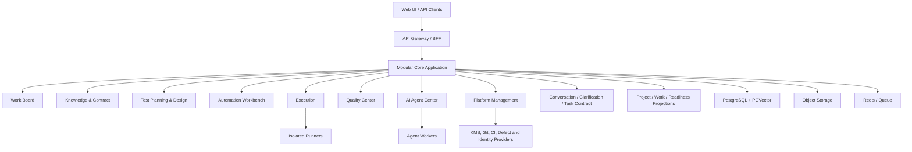

# 31-系统架构设计

> 目标架构服务于四产品平面、八业务能力域、对话+结构化工作台协作，以及事实/推断/评估/人工决定分层。Stage 4已实现的单机切片不包含39号人机协作契约。

## 1. 逻辑架构

当前可运行路径为`React审核工作台 → FastAPI → SQLite`，生成侧为进程内`deterministic-local` Provider，人工审核是唯一正式状态推进门。目标拓扑如下：



V1优先模块化单体+分离Agent/Runner Worker。图中模块是代码和数据Owner边界，不等同于必须独立部署的微服务。

## 2. 业务真相与数据流

| 层 | 真相源 | 不允许 |
|---|---|---|
| 输入依据 | SourceSnapshot、RequirementVersion、APIContractVersion、KnowledgeEntryVersion | 用检索摘要替代原始来源 |
| 测试意图 | Strategy/Plan/Case/Automation的不可变版本 | 看板复制第二份可写正文 |
| 执行事实 | ExecutionTask/Result/Log/Evidence | AI分析反写结果 |
| AI推断 | ResultAnalysis、FailureCluster、AgentTrace | 推断伪装确定事实 |
| 人工决定 | ReviewDecision、AuthorizationDecision、报告签署/外部写入批准 | Agent或管理员开关代替人 |

核心链：来源→TestingIR/规则→策略/计划/用例→脚本→执行→分析/Defect/报告→审核。所有跨域引用固定ID、versionId和必要contentDigest。

## 3. 同步与异步交互

- 短CRUD、查询、授权和ReviewDecision使用REST事务。
- 导入、生成、检查、执行、分析、报告和外部同步建模为WorkItem/attempt异步执行。
- 状态改变在本地事务内写业务数据和Outbox候选事件；消费者幂等处理。
- WebSocket只投递ExecutionTask、WorkItem、AgentTrace和Workspace事件；高价值命令仍走REST。
- 事件包含eventId、sequence/offset、tenant/workspace、resource/version、occurredAt和traceId。

## 4. 事务与一致性

优先原则：在一个聚合/模块内使用PostgreSQL本地事务；跨模块用显式Workflow、Outbox/Inbox、幂等和补偿。并非所有跨域动作都需要通用Saga。

### Workspace创建

V1可在平台模块本地事务创建Workspace和必要默认配置；AI扫描、知识导入、Runner/CI绑定不是同步创建条件，作为后续WorkItem执行。失败不制造AIContext等可写影子实体。

### 正式产出物发布

```text
锁定ReviewTask和产出版本 → 重算授权/策略/职责分离
→ 校验contentDigest和blockingChecks → 追加ReviewDecision/AuthorizationDecision
→ 推进稳定根approved/published指针 → 写Outbox事件
```

任何一步失败回滚事务；外部写入在内部批准完成后使用独立SyncAttempt，不与内部事务做分布式强一致。

## 5. Agent编排

```mermaid
flowchart LR
  WI["WorkItem + version locks"] --> PRE["Structure & authorization preflight"]
  PRE --> REQ["Requirement / IR Agent"]
  REQ --> VERIFY1["Independent IR verification"]
  VERIFY1 --> DESIGN["Strategy → Plan → Scenario → Case → Assertion"]
  DESIGN --> VERIFY2["Assertion & Coverage verification"]
  VERIFY2 --> HITL["ReviewTask / BLOCK_HUMAN"]
  HITL --> HUMAN["Human ReviewDecision"]
  HUMAN --> PUBLISH["Owner application service publishes"]
```



Gate 0机器配置以55号和`prototypes/agent-governance/`为准：1 Supervisor+3受限Subagent、14个Skill。LangGraph仅是候选实现；Agent不得直接写权威源或拥有humanOnly能力。

每个Session锁定Agent/Skill/Prompt/Workflow和来源版本；记录可审计决策摘要、tool输入输出摘要、verdict、成本和Trace，不持久化隐藏思维链。

V1目标编排先以Conversation承载意图，再固化TaskCard/AgentPlan/TaskContract。协调Agent只负责澄清与委派，专业Agent负责生产/执行，评估Agent对冻结产出独立评分。阶段交接和运行控制是REST命令，WebSocket只推送状态与回执。目标实体和激活门禁见39号。

## 6. 执行架构

1. ExecutionPlanVersion冻结用例、脚本、契约基线、环境和资产摘要。
2. Scheduler按Runner capability、Workspace范围、配额和资源池分配租约。
3. Runner在隔离环境拉取只读版本和短时Secret，执行并流式上传日志/证据。
4. 每个attempt追加ExecutionResult；重试不覆盖。
5. 质量分析与缺陷模块在结果完成后异步创建分析WorkItem。

Runner与平台控制面分离；被测网络、Secret和浏览器/代码执行是高风险边界，需容器/沙箱、出站策略、资源限制和制品脱敏。

## 7. 安全架构

- 网关认证后，服务端按当前RoleBinding/ReviewPolicy/资源状态授权，不信任客户端角色Header。
- 平台/租户/Workspace/资源四级作用域；RLS是纵深防御。
- Agent权限取用户、Agent、Workflow、WorkItem和环境策略交集，减去Deny/humanOnly。
- Secret由KMS/Vault保护并按次短时使用；用户/Agent不直接读取明文。
- 外部集成配置目标allowlist、操作、作用域和credentialRef；写入逐次批准和幂等。
- 审计/结果/Trace/决定等事实表只追加。

## 8. 可观察性与故障处理

traceId贯通API→WorkItem→Agent/Runner→外部attempt。失败分类至少区分业务FAIL、平台/环境ERROR、权限DENY、人工BLOCK和CANCEL/TIMEOUT。

故障处理：保存已完成证据；停止未开始节点；重试受预算和幂等约束；版本/权限变化立即熔断；恢复创建新attempt并引用原运行。

## 9. 部署演进

| 阶段 | 建议拓扑 |
|---|---|
| V0 | 文档、静态原型和本地验证，无部署承诺 |
| Stage 4本地 | React + FastAPI + SQLite + 本地JWT + 确定性Provider；不接真实模型 |
| V1 | Modular Core + Agent Worker + Runner + PostgreSQL + Object Storage；按需Redis |
| V2 | 按负载分离执行/Agent Worker，增加队列、多Runner和集成隔离 |
| V3 | 基于实测瓶颈拆服务、弹性资源池、故障域和企业隔离 |

## 10. 架构验收

- OpenAPI/DB/事件/RBAC与03/04/21/32/33/34/36一致。
- 从来源到报告/Review的正反向链可重建。
- Agent尝试批准、跨租户访问、未授权Secret/网络和陈旧版本均fail-closed。
- Runner重试保留全部attempt，分析不改执行事实。
- 外部同步冲突/超时保留逐次回执且不假报成功。
- 静态文档通过不等于架构已在运行环境验证；V1需Spike、迁移、契约和E2E证据。
