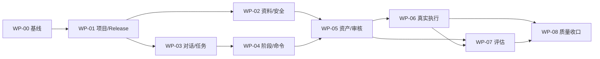

# QualityForge V1 目标契约激活与实现 Backlog

> 状态：现行实施编排基线
> 日期：2026-08-27
> 产品输入：06-人机协作与V1业务基线、23-产品裁决追溯矩阵
> 目标契约：39-人机协作目标契约
> 主入口：本文是57项产品裁决从需求基线进入契约、后端、前端和E2E的唯一实施Backlog

## 1. 完成定义

一项裁决只有同时满足以下条件，才能从`CONTRACT_PENDING/IMPLEMENTATION_PENDING`转为`VERIFIED`：

1. 32号OpenAPI已定义具体请求、响应、错误码、幂等和operationId；
2. 33号DDL与38号迁移已落地约束、索引、RLS/应用层隔离、只追加和回滚；
3. 后端路由、Schema、领域服务、存储和事件已实现，且运行时OpenAPI与32号一致；
4. 前端调用真实API，不以mock、本地状态或随机releaseId伪造业务完成；
5. 完成正常、异常、权限、陈旧版本、取消/恢复、幂等和证据回读测试；
6. 23号矩阵状态、35号CHANGELOG和当期验收报告已同步；
7. 以新鲜运行输出而非文档、页面或Agent自述作为完成证据。

## 2. 当前实现起点

| 维度 | 已验证事实 | 与目标的差距 |
|---|---|---|
| OpenAPI | 89 paths / 117 operations / 113 schemas；标准解析通过 | 39号Conversation、Clarification、TaskContract、RunCommand、Evaluation和投影路径未激活 |
| 后端 | FastAPI运行时登记56 operations；现有auth/planning/quality/observability四个路由面 | 无协作对话、澄清、计划批准、完整运行命令和独立业务评估运行时 |
| 存储 | SQLite可持久当前纵向切片；目标PostgreSQL DDL已有大部分业务表 | 39号新实体只有概念清单，无可执行迁移、约束和保留策略 |
| 前端 | React/Vite已有看板、审核、资产、执行、质量、Agent和平台页 | 首屏默认`/artifacts`；“测试产出物”仍为一级菜单；项目/Release切换是演示态；工作项创建使用随机releaseId |
| Agent控制 | 后端已有`createAgentSession`与Trace读取 | 前端无创建Session调用；AI运行“中断”禁用；工作项取消只改前端本地状态 |
| 验收 | 当前契约测试5/5通过 | 无57项裁决对应的代表性项目新E2E证据 |

上表是本Backlog的起点，不得被后续目标文档改写成“已实现”。

### 2.1 与旧M1～M5开发计划的关系

| 旧计划内容 | 处置 | 原因 |
|---|---|---|
| 已有审核、看板、执行、分析、报告、Provider和前端页面的实现/测试证据 | 保留为当前实现输入 | 已存在的可验证事实不因新裁决失效，但需按新主旅程重组 |
| “八模块导航骨架”、“Journey A/B/C”、默认测试产出物首页 | 被06号与本Backlog覆盖 | 与QF-PD-003/009/010/041不一致 |
| 只依赖现有`createAgentSession`的一次性生成链 | 作为待迁移技术切片 | 新基线要求Conversation、Clarification、TaskCard/AgentPlan确认与六类运行命令 |
| 旧M1～M5的已完成声明 | 只保留原日期证据口径 | 不能被引用为57项新裁决的验收证据 |

因此，旧计划不删除、不改写历史证据；从2026-08-27起，新增开发范围、依赖和完成口径以本Backlog为准。

## 3. 契约激活规则

### 3.1 垂直切片，禁止大爆炸式激活

每个工作包按固定顺序推进：

`ADR/业务规则 → OpenAPI → DB/迁移 → 后端 → 前端 → 正反测试 → 验收证据 → 状态回填`

- 尚未实现的路径可先进入32号目标契约，但必须同步进入`KNOWN_DEFERRED`清单。
- 运行时路由合入时，必须从延期清单转入已实现清单，两者数量必须重新实算。
- 前端可基于契约mock并行开发，但只有切换真实API并通过E2E才计入完成。
- 命令、批准、授权和外部写入不得使用通用PATCH或WebSocket上行代替专用命令契约。

### 3.2 工作包状态

| 状态 | 判定条件 |
|---|---|
| `BACKLOG` | 需求已进入本表，未冻结契约增量 |
| `CONTRACT_READY` | OpenAPI/DDL/权限/事件/正反验收草案已审核 |
| `CONTRACT_ACTIVE` | 契约已合入且机械验证通过，未实现项已登记延期 |
| `BACKEND_DONE` | 运行时路由、服务、存储和后端正反测试通过 |
| `FRONTEND_DONE` | 真实API模式、全状态UI与组件测试通过 |
| `VERIFIED` | 代表性项目E2E、证据回读和独立验收通过 |

## 4. 实施工作包

### WP-00 基线与口径收口

| 属性 | 内容 |
|---|---|
| 目标 | 消除导航、版本范围、当前实现数和旧里程碑之间的口径冲突 |
| 裁决 | 无；本包是所有实施包的文档口径前置 |
| 交付 | 权威基线、本Backlog、当前实现快照、旧计划失效/沿用清单 |
| 验收 | 分面不冒充导航；能力域不冒充一级菜单；“测试产出物”明确取消一级入口；117/56口径与契约测试一致 |
| 规模/风险 | S / 低 |
| 状态 | `CONTRACT_READY`（口径已收口；不代表导航和业务功能已实现） |

### WP-01 真实项目、Release与驾驶舱上下文

| 属性 | 内容 |
|---|---|
| 目标 | 消除前端样例项目与随机releaseId，建立最近有效更新项目/发布上下文 |
| 裁决 | QF-PD-001、002、009、010、020、023、024、025、026、027 |
| 契约 | 激活现有Workspace/Release列表与详情路径；新增`getProjectContextProjection`和有效业务事件口径 |
| 数据 | 实装Workspace/Release持久化和`lastBusinessUpdatedAt`投影；Release必须属于当前Workspace |
| 后端 | 项目/Release列表、默认选择、常用项目固定、投影查询和跨Release隔离 |
| 前端 | 上下文Provider、真实项目/Release切换、路由上下文传递；删除随机releaseId和固定样例项目 |
| 负向验收 | 不存在/归档/跨Workspace Release；轮询、Trace或草稿不刷新项目排序 |
| 依赖 | WP-00 |
| 规模/风险 | L / 高（当前上下文是演示态） |

### WP-02 资料目录、完整性、冲突与数据安全门禁

| 属性 | 内容 |
|---|---|
| 目标 | 让AI可检索全部授权资料，但每次调用按目的最小化装载并通过L1-L4门禁 |
| 裁决 | QF-PD-015、028、029、030、031、032、037、040 |
| 契约 | ProjectMaterial/Version、MaterialConflict/Decision、CompletenessCheck、TestBasisBaseline；导入复用现有SourceSnapshot而不建第二份原文真相 |
| 数据 | 稳定资料根+不可变版本；权威等级、owner、dataClass、digest、冲突决定和保留策略 |
| 后端 | FILE/GIT/OPENAPI/POSTMAN连接面；Markdown/DOCX/PDF/表格类型识别；完整性规则；DLP/脱敏/供应商匹配；L3审批、L4阻断 |
| 前端 | 资料目录、版本/差异、权威等级、完整性结果、冲突裁决和安全阻断界面 |
| 负向验收 | 越权资料、未分级资料、脱敏失败、L4出域、冲突未裁决、完整性不足时均fail-closed |
| 依赖 | WP-01 |
| 规模/风险 | XL / 极高（数据安全与多格式摄取） |

### WP-03 Conversation、Clarification与结构化任务

| 属性 | 内容 |
|---|---|
| 目标 | 建立首屏可持续协作对话，并把自然语言意图转为可审计任务 |
| 裁决 | QF-PD-003、011、012、022、052、053、057 |
| 契约 | 39 §3全部路径；Conversation/Message、ClarificationRequest/Response、TaskCard、AgentPlan/Decision、TaskContract |
| 数据 | 对话与消息只追加；敏感正文存引用；TaskCard/AgentPlan版本和摘要不可静默改写 |
| 后端 | 对话编排、澄清阻塞/解除、计划生成、计划批准、TaskContract固化；仅批准计划可启动Session |
| 前端 | 对话框、引用/权限/预算展示、澄清卡、任务卡和AgentPlan确认；对话错误不丢失已输入草稿 |
| 负向验收 | 无Release执行、未批准计划、未解高风险澄清、陈旧TaskCard、跨Workspace对话、Agent自行批准 |
| 依赖 | WP-01；正式策划任务还依赖WP-02完整性结果 |
| 规模/风险 | XL / 高 |

### WP-04 父子阶段、运行命令、预算与检查点

| 属性 | 内容 |
|---|---|
| 目标 | 把“人工控制Agent”落地为服务端可恢复、可审计的命令和阶段状态机 |
| 裁决 | QF-PD-004、005、021、035、036、051、054、055、056 |
| 契约 | 39 §4-§5；阶段激活/失效命令；六类RunCommand、Receipt、RuntimeAuthorization、BudgetPolicy、Checkpoint |
| 数据 | 父子WorkItem、阶段类型、依赖图、命令/回执只追加、预算快照和检查点不可变 |
| 后端 | 安全点暂停/取消；恢复重做预检；重试创建新attempt；输入变化只失效受影响下游；超预算自动暂停 |
| 前端 | 运行控制条、二次确认、命令待生效/已生效/拒绝状态、恢复点与预算提示；删除本地演示取消 |
| 负向验收 | 命令重放、非Owner取消、已终态恢复、陈旧检查点、预算越界、Agent自行授权、WebSocket上行命令 |
| 依赖 | WP-03 |
| 规模/风险 | XL / 极高（状态机与并发） |

### WP-05 正式资产、审核和阶段交接

| 属性 | 内容 |
|---|---|
| 目标 | 使策略、计划、用例和API代码只有在评估+人工审核+发布后才能激活下游 |
| 裁决 | QF-PD-007、014、016、019、039 |
| 契约 | 审核继续复用ReviewTask/Decision；为各Owner定义`APPROVED → PUBLISHED`发布命令与`StageActivated/Invalidated`事件 |
| 后端 | 输入摘要复核、风险审核策略、可选双人复核、新版本失效下游、KnowledgeCandidate发布 |
| 前端 | 统一待办与业务页就地审核；明确DRAFT/EVALUATING/IN_REVIEW/APPROVED/PUBLISHED/STALE |
| 负向验收 | AI自批、摘要漂移、自己生成自己审批、单人绕过双审、APPROVED未PUBLISHED即下游 |
| 依赖 | WP-02、WP-03、WP-04 |
| 规模/风险 | XL / 高 |

### WP-06 Preflight、真实API Runner、人工执行与不可变证据

| 属性 | 内容 |
|---|---|
| 目标 | 以一条真实API自动化和一条人工测试记录证明统一执行/证据模型 |
| 裁决 | QF-PD-008、017、018、038 |
| 契约 | ExecutionPlanVersion冻结字段；Preflight结果/豁免；人工与API actor/runner语义；EvidenceAnnotation |
| 后端 | 发布版本冻结、环境/凭据/预算预检、真实HTTP请求、超时/取消/重试、原始请求响应/日志/回执只追加 |
| 前端 | 执行基线确认、Preflight结果、人工步骤结果/证据录入、API运行监控和证据回读 |
| 负向验收 | 未发布资产、陈旧基线、无权SecretRef、Runner不兼容、Preflight阻断绕过、证据覆盖、取消后假成功 |
| 依赖 | WP-01、WP-02、WP-04、WP-05 |
| 规模/风险 | XXL / 极高（V1真实业务闭环） |

### WP-07 独立评估Agent与质量投影

| 属性 | 内容 |
|---|---|
| 目标 | 对正式资产与执行证据进行独立、可校准、可解释的在线/离线评估 |
| 裁决 | QF-PD-006、042、043、044、045、046、047、048、049、050 |
| 契约 | EvaluationRun/DimensionResult/BlockingIssue、RubricVersion、CalibrationSample、BenchmarkRun、ReleaseReadinessProjection |
| 数据 | 评估输入摘要冻结；生产/评估Session分离；Rubric和校准版本化；评分结果只追加 |
| 后端 | 确定性硬门优先；分维度评估；阻断/风险路由；人工结果转校准样本；固定基准集离线回归 |
| 前端 | 项目趋势/阻断；业务页维度得分+证据；Agent中心Rubric/校准/漂移治理 |
| 负向验收 | 执行Agent自评、评估Agent修改被评对象、无Rubric/无校准分数驱动通过、严重阻断被平均分掩盖 |
| 依赖 | WP-05；执行证据评估依赖WP-06 |
| 规模/风险 | XXL / 极高（效果校准而非只是功能开发） |

### WP-08 内部Defect、报告、Release裁决、知识回流与代表性验收

| 属性 | 内容 |
|---|---|
| 目标 | 收口从真实结果到人工发布裁决的V1纵向闭环 |
| 裁决 | QF-PD-013、033、034、041 |
| 契约 | 复用ResultAnalysis/Defect/TestReport/Knowledge契约；补齐ReleaseDecision、签署、条件通过和反向追溯投影 |
| 后端 | 失败聚类、分析修订、内部Defect真相源、报告签署、AI建议+人工ReleaseDecision、KnowledgeCandidate审核发布 |
| 前端 | 分析/缺陷/报告/发布裁决页；从结论反查需求、资产版本、命令、运行和原始证据 |
| 终验 | 使用一个真实可控Workspace+Release，跑通资料→计划→资产→API执行→证据→评估→人工裁决→知识回流；关键链路无mock |
| 负向验收 | 外部缺陷平台不可用不阻断内部闭环；AI不得做ReleaseDecision；报告不得引用草稿或被覆盖证据 |
| 依赖 | WP-01～WP-07 |
| 规模/风险 | XXL / 极高 |

## 5. 依赖与并行关系

可并行边界：

- WP-02与WP-03可在WP-01稳定后并行，但正式策划任务必须等WP-02资料门禁。
- WP-06的Runner/证据实现和WP-07的资产评估可部分并行，执行证据评估必须等WP-06。
- 前端原型可在WP-01～WP-04的功能与状态契约冻结后开始；原型不构成任一WP实现证据。

## 6. 首个开发切片：WP-01A

为避免同时开工多个高风险工作包，首个可实施切片固定为`WP-01A 真实项目/Release上下文`：

### 6.1 范围

1. 实装已在32号定义的Workspace/Release查询契约，缺失字段先契约先行补齐；
2. 建立服务端最近有效业务更新口径和项目/Release选择结果；
3. 前端建立全局Workspace/Release Context，删除随机UUID与固定样例项目；
4. 默认路由仍可临时指向现有页，但必须用真实项目/Release上下文；首屏视觉改版不在本切片内。

### 6.2 最小验收

- 正常：登录后选中最近有效更新Workspace和其最近活跃Release，创建WorkItem使用该releaseId。
- 切换：切换Workspace后重置Release、刷新待办/资产查询，不残留上一Workspace数据。
- 负向：跨Workspace releaseId、已归档Release或缺Release的交付任务被服务端拒绝。
- 排序：Agent Trace和前端轮询不更新`lastBusinessUpdatedAt`。
- 证据：后端pytest、前端vitest、浏览器E2E和API响应摘要全部归档。

### 6.3 明确不包含

- AI对话、首屏视觉设计、AgentPlan、运行命令和评估Agent；
- 新增Project实体；UI项目仍对应Workspace；
- 用mock新增一套项目/发布真相源。

## 7. 排期与范围控制

- 本Backlog只使用S/M/L/XL/XXL表示相对规模；未完成技术Spike和执行主体确认前，不承诺日历工期。
- 每个工作包再分为可在2天内合并的短切片；大于400行的单一PR必须继续拆分。
- 任何扩展Web UI自动化、任意Workflow设计器、多租户运营或开放Skill市场的需求，必须作为V1范围变更单独裁决。
- 某个页面可打开、某个接口返200或某个Agent报告成功，均不足以宣称工作包完成。

## 8. 裁决覆盖检查

| 工作包 | 裁决ID |
|---|---|
| WP-00 | 无（文档与口径前置） |
| WP-01 | 001, 002, 009, 010, 020, 023, 024, 025, 026, 027 |
| WP-02 | 015, 028, 029, 030, 031, 032, 037, 040 |
| WP-03 | 003, 011, 012, 022, 052, 053, 057 |
| WP-04 | 004, 005, 021, 035, 036, 051, 054, 055, 056 |
| WP-05 | 007, 014, 016, 019, 039 |
| WP-06 | 008, 017, 018, 038 |
| WP-07 | 006, 042, 043, 044, 045, 046, 047, 048, 049, 050 |
| WP-08 | 013, 033, 034, 041 |

上表必须通过机械检查：001～057每个ID恰好出现一次。一项决策的实现需跨多个工作包时，以上表的Owner工作包负责最终验收，其他工作包作为依赖。
