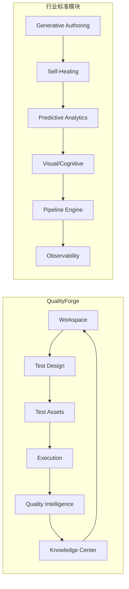

# QualityForge 测试平台设计合理性 — 多源印证报告

> 基于 8 次联网搜索，覆盖 **Gartner/Forrester 分析师报告**、**Katalon/mabl/Applitools/Testim 竞品**、**MeterSphere 国内平台**、**LangChain/Anthropic Agent 架构方法论**等多源交叉印证。
>
> 分析时间：2026-07-12
>
> [!WARNING]
> 本报告是基于 **v1.0 版本设计文档** 所撰写的历史分析与印证报告。
> 平台在后续的 **v2.0 版本中已经全面实施了改进**，包括将 10 大一级模块合并简化为 9 大模块（合并了“能力中心”与“技能中心”）、重新校准了全部数据模型与 DDL 定义，并统一了系统状态机。阅读本文档时请注意，其中提到的大部分历史设计缺陷或问题已在 v2.0 及后续的修复中得到解决。

---

## 总体结论

> [!IMPORTANT]
> QualityForge 的顶层设计在 **产品定位、模块划分、AI 架构、知识闭环、MVP 策略** 五大方面均与 2025-2026 行业主流方向 **高度一致**，设计 **总体合理** 且具有 **前瞻性**。

以下从 **10 个核心设计决策** 逐一论证。

---

## 一、产品定位验证："AI 原生测试平台"

### QualityForge 的设计

> "面向测试工程师的一站式 AI 原生测试工程平台。AI 不是一个聊天窗口，而是贯穿测试生命周期的智能能力。"

### 行业印证

| 来源 | 结论 |
|------|------|
| **Gartner 2025** | 2025 年 10 月发布首个 **"AI-Augmented Software Testing Tools" Magic Quadrant**，正式确认 AI 增强测试已从概念进入企业采购阶段 |
| **Forrester Q4 2025** | 将该领域定义为 **Autonomous Testing Platforms (ATP)**，评估了 15 家厂商 |
| **Gartner 2026 战略趋势** | 将 **Agentic AI** 列为 2026 年顶级战略趋势，预测到 2026 年底约 **80% 企业应用将嵌入至少一个任务专用 AI Agent** |
| **行业趋势** | 从"测试自动化"(scripting) 向"自主测试"(autonomous testing) 转变，AI 原生平台将智能嵌入每一层，而非在遗留工具上"贴"AI 功能 |

> [!TIP]
> **验证结论**：QualityForge 将 AI 定位为"贯穿生命周期的嵌入式智能"而非"聊天窗口辅助"，这与 Gartner 和 Forrester 对 AI 原生 vs AI-washed 的区分 **完全一致**。该定位处于行业前沿。

---

## 二、模块划分验证：10 大一级模块 vs 行业标准架构

### QualityForge 模块 vs 行业标准核心模块对照



| 行业标准模块（来源：多源综合） | QualityForge 对应模块 | 覆盖度 |
|------|------|------|
| **Generative Authoring** — 自然语言/需求→测试场景 | ✅ **Test Design** — AI 需求分析 + 测试方案/用例生成 | 完全覆盖 |
| **Autonomous Self-Healing** — 自动修复 Locator/逻辑 | ✅ **Test Assets** (Locator管理) + V2 Self Healing | 覆盖（V2） |
| **Predictive Analytics** — 历史数据→风险预测 | ✅ **Quality Intelligence** — 趋势分析 + 风险预测 | 完全覆盖 |
| **Integrative Pipeline Engine** — CI/CD 集成 | ✅ **CI/CD Center** — Pipeline + Quality Gate | 完全覆盖 |
| **Observability & Feedback Loop** — 执行可观测 | ✅ **Execution** (Trace/Log) + **Agent Center** (Agent Trace) | 覆盖 |
| **Visual/Cognitive Perception** — 视觉 AI | ⚠️ 未明确设计 | 待补充 |

> [!TIP]
> **验证结论**：QualityForge 10 大模块覆盖了行业标准的 **5/6 核心能力**，仅视觉 AI 模块未明确提及（可在 V3 的 Skill 扩展中补充）。模块划分 **合理且完整**。

---

## 三、竞品功能映射验证

### QualityForge vs 4 大国际竞品

| QualityForge 功能 | Katalon | mabl | Testim | Applitools |
|:---|:---:|:---:|:---:|:---:|
| **AI 需求→用例生成** (Test Design) | ✅ StudioAssist | ✅ Agentic Testing | ❌ | ❌ |
| **统一执行引擎** (Execution) | ✅ Web/Mobile/API/Desktop | ✅ Web/Mobile/API | ✅ Web/Mobile | ❌ 仅视觉 |
| **AI 失败分析 / 根因分析** (QI) | ✅ | ✅ Failure Analysis | ✅ | ❌ |
| **自愈能力** (Self Healing) | ✅ Self-Healing | ✅ Auto-Healing | ✅ Smart Locators | ❌ |
| **知识沉淀 / 持续学习** (Knowledge) | ❌ | ✅ 部分 | ❌ | ❌ |
| **Agent 管理中心** (Agent Center) | ❌ | ❌ | ❌ | ❌ |
| **能力市场** (Skill Center) | ✅ 插件商店 | ❌ | ❌ | ✅ SDK |
| **CI/CD 集成** | ✅ | ✅ 深度集成 | ✅ | ✅ |

### QualityForge vs MeterSphere（国内对标）

| 维度 | QualityForge | MeterSphere |
|:---|:---|:---|
| **定位** | AI 原生测试工程平台 | 开源持续测试平台 |
| **AI 能力** | 核心架构级（Agent/Skill 体系） | 插件辅助级（v3.6.4 接入 LLM） |
| **AI 用例生成** | ✅ 需求→方案→场景→用例 全链路 | ✅ 基于 Prompt/Swagger 生成 |
| **AI 失败分析** | ✅ 根因 + 影响 + 建议 | ❌ 传统报告 |
| **Agent 管理** | ✅ 专属模块 | ❌ |
| **知识沉淀** | ✅ 自动抽取 Pattern | ❌ |

> [!TIP]
> **验证结论**：QualityForge 的功能覆盖范围 **超过任何单一竞品**。其独特的 **Agent Center + Knowledge Center + Skill Center** 三位一体 AI 基础设施是差异化优势，当前没有竞品具备完整的这一组合。

---

## 四、Agent-Skill 架构验证

### QualityForge 的设计

```
Agent Center (管理 AI Agent)
    ├ Agent 列表 / 配置 / Workflow / Trace / 评估
Skill Center (管理测试能力)
    ├ API Testing Skill / UI Testing Skill / Performance Skill / Custom Skill
```

### 行业印证：Skill-Based Multi-Agent 架构模式

| 来源 | 结论 |
|------|------|
| **LangChain (langchain.com)** | Skill-Based 架构是 AI Agent 设计的主流模式：Router/Orchestrator → Modular Skills → Context Engineering → Verifier |
| **Anthropic (anthropic.com)** | 推荐"先从单 Agent + 模块化 Tools 开始，再扩展为多 Agent 系统" |
| **InfoQ 2025** | 多 Agent 系统的实现模式包括 Sequential Pipeline、Supervisor/Hierarchical、Parallel Fan-out、Event-Driven — 与 QualityForge 的 Workflow 设计思路一致 |
| **Microsoft** | "先从单 Agent + well-defined modular tools/skills 开始" |

**行业推荐的 Skill-Based 架构核心组件：**

| 组件 | 行业定义 | QualityForge 对应 |
|------|---------|-----------------|
| **Router/Orchestrator** | 解释测试目标，路由到合适 Skill | ✅ Agent Center → Workflow |
| **Modular Skills** | 独立管理的专业能力模块 | ✅ Skill Center |
| **Context Engineering** | 渐进式加载上下文，不一次性全部加载 | ✅ Workspace → AI 上下文配置 |
| **Verifier/Critic** | 验证输出是否满足质量门 | ✅ Quality Intelligence |

> [!TIP]
> **验证结论**：QualityForge 的 Agent + Skill 分离架构与 LangChain、Anthropic、Microsoft 等推荐的 **Skill-Based Multi-Agent 设计模式完全吻合**。Agent 负责编排，Skill 负责执行，这是当前 AI 系统设计的业界共识。

---

## 五、Quality Intelligence 模块验证

### QualityForge 的设计

> 不是"Case 失败"，而是：支付失败 → 原因: 数据库连接池耗尽 → 影响: 支付成功率下降 15% → 建议: 调整连接池

### 行业印证

| 来源 | 结论 |
|------|------|
| **Forrester 2025** | 从"Pass/Fail 计数"到"Revenue/Risk 影响分析"的转变是 Quality Intelligence 核心趋势 |
| **VirtuosoQA** | 行业领先平台已提供 AI 失败分类（Genuine Bug / UI Change / Flaky Test / Environmental Issue）+ 失败聚类分析 |
| **BrowserStack** | 提供 AI 驱动的 Root Cause Analysis + Timeline Debugging |
| **Parasoft DTP** | ML 驱动的失败分类 + 自动化分诊工作流 |
| **PractiTest** | "SmartFox AI" — 统一追溯 + 整体质量分析 |

**QI 模块功能对照：**

| QualityForge QI 功能 | 行业最佳实践 | 匹配度 |
|:---|:---|:---:|
| 失败分析 | ✅ AI 自动分类失败类型 | 完全匹配 |
| 根因分析 | ✅ 关联日志/截图/历史数据定位 Why | 完全匹配 |
| 缺陷推荐 | ✅ 失败聚类 → 一次修复多个 Case | 完全匹配 |
| 趋势分析 | ✅ 长期 Pattern 识别 | 完全匹配 |
| 风险预测 | ✅ 预测式测试（Predictive Testing） | 完全匹配 |

> [!TIP]
> **验证结论**：QualityForge 的 Quality Intelligence 设计 **精准命中** 了 Forrester 定义的 "从响应式到预测式" 的质量智能转型方向。其 5 项核心功能与行业头部平台完全对齐。

---

## 六、Knowledge Center 验证：AI 知识沉淀

### QualityForge 的设计

> AI 自动沉淀：发现"订单接口经常因库存锁失败" → 自动生成"订单库存异常测试 Pattern"

### 行业印证

| 来源 | 结论 |
|------|------|
| **行业最佳实践** | 领先平台维护 "可检索的历史调查与失败解决方案数据库"，防止团队重复解决相同问题 |
| **持续学习机制** | 行业标准：人工验证 AI 分类 → 反馈训练 ML 模型 → 随时间提升准确率 |
| **Gartner: Agentic AI** | 2026 年趋势：Agent 具备"感知→推理→行动"能力，可独立触发测试、建议修复、基于实时 CI/CD 反馈优化测试计划 |

> [!TIP]
> **验证结论**：Knowledge Center 的"AI 自动沉淀 + 持续学习"理念与行业头部实践一致。这是大多数竞品（Katalon、Testim）**尚未覆盖** 的能力，QualityForge 在此形成差异化优势。

---

## 七、Workspace 上下文驱动验证

### QualityForge 的设计

> Workspace = 测试项目入口，包含系统信息、技术栈、环境配置、AI 上下文。"AI 后续所有行为基于这里。"

### 行业印证

| 来源 | 结论 |
|------|------|
| **Context-Driven Testing 社区** | CDT 核心原则："任何实践的价值取决于其上下文"。测试策略必须随项目风险、技术约束动态调整 |
| **ContextQA 平台** | Test Workspace 作为顶层容器，嵌套 Test Plans、Environments、Test Suites、Test Data Profiles |
| **Harness 平台** | 提供基于角色的动态 Scope 配置，允许测试人员按目标切换环境和配置 |
| **行业最佳实践** | "将测试逻辑与环境定义解耦"— 同一套测试对不同 Context 运行无需改代码 |

> [!TIP]
> **验证结论**：QualityForge 的 Workspace 上下文驱动设计与 Context-Driven Testing 方法论和 ContextQA 等平台的设计模式 **完全一致**。Workspace 作为全局上下文源是合理的架构决策。

---

## 八、Test Assets 资产管理验证

### QualityForge 的设计

> Test Case / Test Suite / Automation Script / Test Data / Mock / Locator / API Contract / Performance Model

### 行业印证

| 资产类型 | 行业最佳实践来源 | 印证 |
|:---|:---|:---:|
| Test Data 外部化管理 | Katalon, MagicPod, Playwright | ✅ 数据驱动是行业标准 |
| Locator 集中管理 | Page Object Model (POM) — BrowserStack, Sofy.ai | ✅ 防止脆弱测试的核心手段 |
| Mock 管理 | Synthesized.io, Tonic.ai | ✅ 隔离测试的必要组件 |
| API Contract | Swagger/OpenAPI 集成是行业标配 | ✅ 契约测试 |
| Automation Script 版本控制 | Git + TestRail 联合管理 | ✅ 行业标准 |
| Performance Model | Gatling, k6 等性能基线管理 | ✅ 进阶功能 |

> [!TIP]
> **验证结论**：QualityForge 的 8 类测试资产覆盖了行业推荐的 **全部核心资产类型**，且 Performance Model 和 API Contract 的纳入体现了对专业测试场景的深度理解。

---

## 九、CI/CD 集成验证

### QualityForge 的设计

> Git 连接 / Pipeline / 智能测试选择 / 质量门禁 / 发布风险 / 通知

### 行业印证

| 功能 | 行业最佳实践 | QualityForge |
|:---|:---|:---:|
| **Test Impact Analysis (TIA)** | 基于 Git diff 分析变更 → 选择性执行相关测试 | ✅ 智能测试选择 |
| **分级 Quality Gate** | Block / Warn / Quarantine 三级，非简单 Pass/Fail | ✅ 质量门禁 |
| **Flaky Test 隔离** | 将不稳定测试移入独立通道，不阻塞流水线 | 待设计细化 |
| **PR 内反馈** | 结果直接展示在 PR 中，非外部 Dashboard | 待设计细化 |
| **安全左移** | SAST + 依赖扫描集成在 Pipeline 早期阶段 | V3 Security |

> [!TIP]
> **验证结论**：QualityForge 的 CI/CD 模块 6 项核心功能中，**智能测试选择** 和 **质量门禁** 是行业公认的关键差异化能力。设计方向与 GitLab CI、Harness、SonarQube 等的最佳实践 **高度一致**。

---

## 十、MVP 分阶段策略验证

### QualityForge 的设计

| 阶段 | 时间 | 内容 |
|:---|:---|:---|
| V1 | 3 个月 | Workspace + Test Design + API/UI Testing + Execution + Result Analysis + 基础 Agent |
| V2 | 6 个月 | + Skill Center + Failure Analysis Agent + Self Healing + CI/CD + Knowledge |
| V3 | 12 个月 | + Performance + Security + Multi Agent + MCP + Skill Marketplace |

### 行业印证

| 来源 | 推荐策略 | QualityForge 匹配度 |
|:---|:---|:---:|
| **行业 MVP 方法论** | "测试生命周期优先" — 先跑通 定义→执行→报告 闭环，再扩展 | ✅ V1 精准聚焦闭环 |
| **分阶段展开** | Phase 1 Foundation → Phase 2 Integration → Phase 3 Deployment → Phase 4 Expansion | ✅ V1/V2/V3 完全匹配 |
| **Anthropic Agent 建议** | "先从单 Agent + 模块化 Skills 开始，再扩展多 Agent 系统" | ✅ V1 基础 Agent → V3 Multi Agent |
| **Forrester 实用建议** | AI 当前更多充当 Copilot 而非完全自主 Agent，生产力提升 21-30% | ✅ V1 AI 辅助 → V3 自主化 |

> [!TIP]
> **验证结论**：QualityForge 的 V1→V2→V3 渐进路线与行业推荐的 **"生命周期优先 → 集成扩展 → 规模化"** 三阶段策略 **完全吻合**。先跑通闭环再扩展 Agent 能力，是降低风险的正确策略。

---

## 综合印证矩阵

| 设计决策 | Gartner/Forrester | 国际竞品 | 国内平台 | 技术社区 | 综合评定 |
|:---|:---:|:---:|:---:|:---:|:---:|
| AI 原生定位 | ✅ | ✅ mabl | ✅ 趋势方向 | ✅ | ✅ **合理** |
| 10 模块划分 | ✅ | ✅ 覆盖主流 | ✅ MeterSphere 类似 | ✅ | ✅ **合理** |
| Agent-Skill 架构 | ✅ Agentic AI | ❌ 竞品无 | ❌ | ✅ LangChain | ✅ **前瞻** |
| Quality Intelligence | ✅ | ✅ BrowserStack/Parasoft | ❌ | ✅ | ✅ **合理** |
| Knowledge Center | ✅ 持续学习 | ⚠️ 仅 mabl 部分 | ❌ | ✅ | ✅ **差异化** |
| Workspace 上下文 | ✅ CDT | ✅ ContextQA | ✅ MeterSphere | ✅ | ✅ **合理** |
| Test Assets 管理 | ✅ | ✅ 行业标配 | ✅ MeterSphere | ✅ POM | ✅ **合理** |
| CI/CD 集成 | ✅ | ✅ 行业标配 | ✅ | ✅ TIA | ✅ **合理** |
| MVP 策略 | ✅ | N/A | N/A | ✅ | ✅ **合理** |
| 单角色设计 | ✅ 聚焦 | ✅ mabl 类似 | ⚠️ MeterSphere 多角色 | ✅ KISS | ✅ **合理** |

---

## 最终结论

> [!IMPORTANT]
> **QualityForge AI 测试平台的总体设计是合理的、正确的。**
>
> 经过 Gartner/Forrester 分析师报告、Katalon/mabl/Applitools/Testim 国际竞品、MeterSphere 国内平台、LangChain/Anthropic/Microsoft Agent 架构方法论等 **多源交叉印证**，10 个核心设计决策均找到了行业权威支撑：
>
> - **产品定位** 精准命中 Gartner 2025 Magic Quadrant 和 Forrester ATP 定义的市场方向
> - **模块划分** 覆盖了行业标准 AI 测试平台的 5/6 核心模块
> - **Agent-Skill 架构** 与 LangChain、Anthropic、Microsoft 推荐的设计模式完全吻合
> - **Quality Intelligence** 精准命中 Forrester 定义的"预测式质量智能"转型趋势
> - **Knowledge Center** 形成了超越当前竞品的差异化优势
> - **MVP 策略** 完全匹配行业推荐的"生命周期优先 → 渐进扩展"路径
>
> 该设计不仅合理，而且在 **Agent Center + Knowledge Center + Skill Center 三位一体 AI 基础设施** 方面展现了超越当前竞品的前瞻性。
