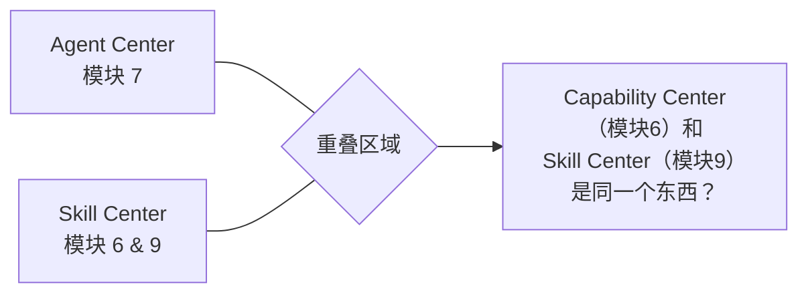
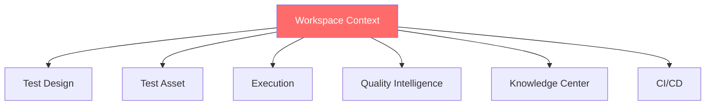

# QualityForge AI 测试平台 — 设计文档分析报告

> 分析范围：目录下全部 13 份设计文档
> 分析时间：2026-07-12
>
> [!WARNING]
> 本报告是基于 **v1.0 版本设计文档** 所撰写的历史分析与审计报告。
> 平台在后续的 **v2.0 版本中已经全面实施了改进**，包括将 10 大一级模块合并简化为 9 大模块（合并了“能力中心”与“技能中心”）、重新校准了全部数据模型与 DDL 定义，并统一了系统状态机。阅读本文档时请注意，其中提到的大部分历史设计缺陷或问题已在 v2.0 及后续的修复中得到解决。

---

## 一、文档全景

| # | 文档 | 定位 | 篇幅 |
|---|------|------|------|
| 01 | [产品功能地图v1.0](../../99-archive/v1/01-产品功能地图v1.0.md) | 产品功能蓝图，10 个一级模块 | 237 行 |
| 02 | `PRD总纲-设计状态与工作流与首页.md`（历史源文件未保留） | 设计状态、工作流、首页 Workbench | 119 行 |
| 03 | [Workspace模块](../../99-archive/v1/03-PRD-Workspace模块.md) | 测试空间上下文建设 | 44 行 |
| 04 | [TestDesign模块](../../99-archive/v1/04-PRD-TestDesign模块.md) | 需求→方案→用例 AI 生成 | 72 行 |
| 05 | [TestAsset模块](../../99-archive/v1/05-PRD-TestAsset模块.md) | 测试资产管理 | 44 行 |
| 06 | [Execution模块](../../99-archive/v1/06-PRD-Execution模块.md) | 统一测试执行 | 35 行 |
| 07 | [QualityIntelligence模块](../../99-archive/v1/07-PRD-QualityIntelligence模块.md) | AI 质量分析 | 29 行 |
| 08 | [AgentCenter模块](../../99-archive/v1/08-PRD-AgentCenter模块.md) | AI Agent 管理 | 29 行 |
| 09 | [SkillCenter模块](../../99-archive/v1/09-PRD-SkillCenter模块.md) | 测试能力市场 | 27 行 |
| 10 | [KnowledgeCenter模块](../../99-archive/v1/10-PRD-KnowledgeCenter模块.md) | AI 知识沉淀 | 25 行 |
| 11 | [CICD模块](../../99-archive/v1/11-PRD-CICD模块.md) | 流水线集成 | 16 行 |
| 12 | [MVP版本规划](../../99-archive/v1/12-MVP版本规划与下一步.md) | V1/V2/V3 路线图 | 54 行 |
| 13 | [xuqiufenxi（现归档名：原始设计讨论记录）](../../99-archive/00-原始设计讨论记录.md) | 原始对话记录整理 | 1159 行 |

---

## 二、设计亮点 ✅（做得好的地方）

### 2.1 产品定位清晰
- **"面向测试工程师的一站式 AI 原生测试工程平台"** — 单一用户角色、不做复杂权限体系，这是正确的产品决策，避免了企业平台常见的"什么都想做"陷阱。
- AI 不是聊天窗口，而是 **贯穿测试生命周期的嵌入式智能** — 这比市面上大部分"套壳 ChatGPT"的测试工具高出一个维度。

### 2.2 工作流闭环完整
```
创建空间 → 导入系统 → AI理解 → 生成方案 → 生成资产 → 执行 → 分析 → 沉淀知识 → 回归
```
覆盖了测试的完整生命周期，且每一步都有 AI 介入点，形成了 **"AI-in-the-loop"** 而非 **"AI-on-the-side"** 的设计哲学。

### 2.3 模块划分合理
10 个一级模块的划分基本遵循了 **高内聚、低耦合** 原则：
- **Workspace** 提供上下文（Context）
- **TestDesign** 负责设计（Design）
- **TestAsset** 负责管理（Management）
- **Execution** 负责执行（Runtime）
- **QualityIntelligence** 负责分析（Analytics）
- **Agent/Skill/Knowledge** 三位一体支撑 AI 能力

### 2.4 MVP 分阶段策略务实
- V1（3个月）聚焦闭环验证，只做 Workspace + TestDesign + API/UI 测试 + 执行 + 分析
- V2/V3 渐进式扩展，避免大而全的一次性交付

### 2.5 Quality Intelligence 差异化定位
从 "Case 失败" 到 "支付失败 → 原因: 数据库连接池耗尽 → 影响: 支付成功率下降 15% → 建议: 调整连接池" — 这是真正的 AI 价值点，比传统测试报告高了一个量级。

---

## 三、关键问题 ⚠️（需要改进的地方）

### 3.1 🔴 严重问题：PRD 深度严重不足

> [!CAUTION]
> 多数模块 PRD 仅有 25-44 行，停留在"功能列表"层面，远未达到"可开发"的需求规格。

**对比分析：**

| 模块 | 当前行数 | 可开发 PRD 应有内容 | 差距 |
|------|---------|-------------------|------|
| Workspace | 44 行 | 数据模型、字段定义、AI 初始化流程、权限、API 接口 | **缺 80%** |
| TestDesign | 72 行 | 输入解析规则、生成算法约束、人工 Review 流程、版本控制 | **缺 70%** |
| Execution | 35 行 | Runner 架构、调度策略、并发模型、失败重试、超时机制 | **缺 85%** |
| QI | 29 行 | 分析模型、数据聚合规则、告警阈值、报告模板 | **缺 90%** |
| Agent Center | 29 行 | Agent 注册协议、Workflow DSL、Trace 格式、评估指标 | **缺 90%** |
| Skill Center | 27 行 | Skill 接口规范、安装/卸载流程、版本兼容性 | **缺 90%** |
| Knowledge | 25 行 | 知识抽取规则、存储结构、检索策略、过期机制 | **缺 90%** |
| CI/CD | 16 行 | Git Hook 集成、Pipeline DSL、Quality Gate 规则 | **缺 95%** |

### 3.2 🔴 严重问题：Agent 与 Skill 边界模糊

文档中存在两个高度重叠的概念：



- **模块 6** 叫 "Test Capability Center"，列出了 API/UI/Performance/Security Skill
- **模块 9** 叫 "Skill Center"，也是 Skill Marketplace
- 两者的区别是什么？文档没有说清楚

> [!IMPORTANT]
> **建议**：合并为一个模块，或明确定义 — Capability Center 是「内置能力」，Skill Center 是「可扩展插件」。

### 3.3 🟡 中等问题：数据模型完全缺失

整套文档没有定义任何数据模型，以下核心实体缺少定义：

- **Workspace** 的数据结构
- **TestCase** 的字段规范（虽然提到了编号、标题、步骤等，但没有字段类型、约束、关联关系）
- **ExecutionPlan** / **ExecutionTask** 的状态机
- **Agent** 和 **Skill** 的注册协议
- **Knowledge** 的存储模型

### 3.4 🟡 中等问题：AI 介入点设计过于理想化

多处 AI 能力描述缺乏约束条件和降级方案：

| AI 能力 | 理想描述 | 缺少的关键考虑 |
|---------|---------|--------------|
| AI 需求分析 | 上传 PRD → AI 分析出业务流程、风险 | PRD 格式不统一怎么办？分析错误怎么纠正？ |
| AI 生成测试用例 | 自动生成完整用例 | 生成质量如何评估？人工 Review 工作流是什么？ |
| AI 根因分析 | 从失败定位到 "Redis 连接异常" | 需要什么数据源？日志、监控、代码如何接入？ |
| AI 知识沉淀 | 自动抽取 Pattern | 抽取准确率？错误知识如何清理？ |
| AI 自愈 (V2) | Self Healing | 自愈范围？安全边界？回滚机制？ |

### 3.5 🟡 中等问题：非功能需求完全缺失

文档没有涉及：

- **性能要求**：并发用例执行数、报告生成延迟、Agent 响应时间
- **安全设计**：多租户隔离、Secrets 管理、LLM API Key 保护
- **可观测性**：平台自身的监控、日志、告警
- **高可用**：Runner 故障转移、Agent 失败重试
- **数据一致性**：执行中断后资产状态一致性

### 3.6 🟡 中等问题：xuqiufenxi.md 与正式文档高度重复

[xuqiufenxi.md（现归档名：原始设计讨论记录）](../../99-archive/00-原始设计讨论记录.md)（1159 行）是原始对话记录的整理，内容与 01-12 号文档 **95% 重复**。它的存在增加了文档维护成本和歧义风险。

### 3.7 🟢 轻微问题：模块命名不一致

| 位置 | 名称 A | 名称 B |
|------|--------|--------|
| 功能地图 vs PRD | Test Capability Center | Skill Center |
| 功能地图 vs PRD | 测试分析 Quality Intelligence | 质量智能中心 |
| 首页 vs 模块 | Workbench | Workspace |

---

## 四、架构级风险评估

### 4.1 Workspace 上下文 → 全局依赖风险



Workspace 是所有模块的上下文源头。如果 Workspace 的数据模型设计不够灵活，会导致所有下游模块受限。**这是架构上最大的单点风险**。

### 4.2 Agent-Skill 耦合度过高

当前设计中 Agent 直接依赖 Skill，但缺少中间协议层：

```
当前：Agent → 直接调用 Skill
建议：Agent → Skill Protocol → Skill Implementation
```

没有协议层，未来 Skill 升级会直接影响 Agent 稳定性。

### 4.3 Knowledge Center 定位不清

Knowledge Center 同时承担了：
1. **RAG 知识库**（给 AI 检索用）
2. **经验资产库**（给人查看用）
3. **性能基线库**（给自动化比对用）

这三者的数据结构、访问模式、更新频率完全不同，混在一个模块里会导致后期维护困难。

---

## 五、改进建议总结

### 优先级 P0（阻塞开发）

| # | 问题 | 建议 |
|---|------|------|
| 1 | PRD 深度不足 | 为 V1 的 4 个核心模块（Workspace、TestDesign、Execution、QI）补充完整 PRD：数据模型、API 接口、状态机、错误处理 |
| 2 | 数据模型缺失 | 输出核心领域模型 ER 图，至少覆盖 Workspace、TestCase、ExecutionPlan、Agent、Skill |
| 3 | Agent/Skill 边界 | 明确定义 Agent 和 Skill 的职责边界、交互协议、注册机制 |

### 优先级 P1（影响质量）

| # | 问题 | 建议 |
|---|------|------|
| 4 | AI 降级方案 | 为每个 AI 介入点设计 fallback 策略和人工干预机制 |
| 5 | 非功能需求 | 补充性能、安全、可用性、可观测性需求 |
| 6 | 模块合并 | 将 Capability Center 和 Skill Center 合并，消除歧义 |

### 优先级 P2（提升规范）

| # | 问题 | 建议 |
|---|------|------|
| 7 | 文档去重 | 将 xuqiufenxi.md 归档或删除，避免双源维护 |
| 8 | 术语统一 | 建立统一术语表（Glossary），统一命名 |
| 9 | Knowledge 拆分 | 将 Knowledge Center 拆分为 RAG Store / Experience Base / Baseline Store 三个子模块 |

---

## 六、总体评价

| 维度 | 评分 | 说明 |
|------|------|------|
| 产品愿景 | ⭐⭐⭐⭐⭐ | 定位精准，"AI 原生"不是噱头而是贯穿设计 |
| 模块划分 | ⭐⭐⭐⭐ | 基本合理，有少量重叠需收敛 |
| 工作流设计 | ⭐⭐⭐⭐⭐ | 闭环完整，AI 介入点布局合理 |
| PRD 可执行度 | ⭐⭐ | 大部分模块停留在功能清单，无法直接指导开发 |
| 数据模型 | ⭐ | 完全缺失 |
| 非功能需求 | ⭐ | 完全缺失 |
| MVP 策略 | ⭐⭐⭐⭐ | 分阶段务实，但 V1 3 个月时间偏紧 |
| 文档规范 | ⭐⭐⭐ | 结构清晰但深度不够，存在冗余 |

> [!IMPORTANT]
> **总结**：QualityForge 的产品愿景和顶层设计是 **优秀** 的 — 清晰的定位、完整的闭环、AI 原生的理念都值得肯定。但当前文档处于 **"功能蓝图"阶段**，距离 **"可开发 PRD"** 还有显著差距。核心瓶颈在于 **数据模型、交互细节、AI 降级方案、非功能需求** 的缺失。建议在进入 React UI/UX 设计之前，先完成 V1 核心模块的详细 PRD 补充。
