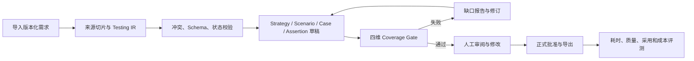

# QualityForge 智能测试平台项目需求综合分析评估报告 v1.0

> 报告日期：2026-07-30  
> 项目阶段：需求设计研发阶段  
> 评估对象：QualityForge 智能测试平台现行需求、产品、领域、接口、数据、AI、架构、原型和验证材料  
> 评估性质：需求分析与项目准入评估，不是生产验收、代码验收或整改实施结果  
> 综合裁决：`REVISE_AND_FOCUS`  
> 建议决策：项目可继续，但暂停完整平台扩张，聚焦“需求到可信测试资产”单一价值链进行验证

---

## 一、执行摘要

### 1.1 总体判断

QualityForge 的产品方向具有潜在价值。现有材料覆盖测试设计、资产、执行、失败分析、知识、Agent、Skill、CI/CD 和平台治理，技术蓝图、安全意识和 AI 降级思路明显强于普通的“AI 生成测试用例”工具。

但从需求工程和投资准入角度看，项目当前存在一个根本性失衡：**解决方案设计的广度和深度，已经显著领先于真实问题、用户价值和正式产品契约的验证程度。**

当前不宜把项目作为完整九模块企业级平台全面推进。更合理的方向是把近期目标收敛为：

> 面向内部测试工程师和测试负责人，将需求材料转换为带来源、业务规则、场景、用例、断言和覆盖证据的测试资产草稿，通过确定性校验和人工评审形成可信正式输出，并测量真实效率、质量、采用和成本。

### 1.2 核心结论

1. **七个需求分析阶段均已执行完成，但多个阶段 Gate 未通过。**分析完成不等于需求成熟或可以全面研发。
2. **真实用户证据不足。**尚未发现正式用户访谈、工作跟随、现状工具链、痛点发生频率、耗时损失和采用意愿基线。
3. **产品范围过宽。**现行蓝图实际组合了至少八类可独立成立的子产品，不适合作为单人、单机、1–3 个月的同一 MVP。
4. **推荐唯一近期价值流。**“需求到可信测试资产”拥有最集中的原型、Skill 和可测闭环，是当前最适合优先验证的方向，但尚未被证明是用户最大的真实痛点。
5. **正式契约存在断层。**Testing IR、Business Rule、Source Trace、Assertion、Coverage 和 Review 已出现在原型质量链中，却没有完整进入术语、领域、数据库和 OpenAPI。
6. **AI 治理尚未达到生产级。**置信度阈值未经校准，多数 Skill 缺少标准 eval；AI 不应拥有正式资产发布、外部写入或发布放行权。
7. **当前 Coverage Gate 未通过。**现有样本中规则覆盖 75%、场景覆盖 33.3%、状态转换覆盖 25%、有效断言覆盖 100%，总体为 `GATE_FAILURE`。
8. **远期架构对验证阶段过重。**微服务、分布式 Runner、消息系统、Kubernetes、多租户等应由实际规模和故障域触发，而不是由“企业级平台”标签预设。
9. **单链本机 V0 可行，完整九模块 V1 当前不可行。**V0 应先证明价值可测、质量可控和用户愿意采用。
10. **最终建议为调整并聚焦。**继续项目，但冻结完整平台范围和未经验证的收益承诺，以阶段 Gate 决定是否扩展。

### 1.3 综合成熟度

综合成熟度评分为 **2.27 / 5**。该分数衡量的是当前证据成熟度，不是否定产品前景。

| 维度 | 权重 | 评分 | 主要判断 |
|---|---:|---:|---|
| 问题真实性与用户证据 | 15% | 1.5 | 无真实访谈、现状观察和基线 |
| 产品定位与范围 | 10% | 2.0 | 愿景明确但边界过宽 |
| 业务闭环 | 10% | 3.0 | 概念闭环完整，真实流程未验证 |
| 功能需求质量 | 10% | 2.8 | 页面和功能较细，业务规则与验收不足 |
| 领域、数据与追溯 | 15% | 2.0 | 正式契约落后于 Skill 原型 |
| AI 质量与治理 | 15% | 2.5 | 有 HITL 思路，阈值和评测不足 |
| 安全与隐私 | 10% | 3.2 | 目标设计较强，AI 数据治理仍有缺口 |
| 架构适配性 | 5% | 1.8 | 远期目标过度驱动当前架构 |
| MVP 与交付可行性 | 5% | 2.0 | 单链 V0 可行，完整 V1 不可行 |
| 指标和经济性 | 5% | 1.5 | 收益目标缺少真实基线 |
| **综合** | **100%** | **2.27** | **未达到完整 V1 准入条件** |

---

## 二、评估目标、范围与方法

### 2.1 评估目标

本次评估从“第一次收到新需求”的视角重新回答：

1. 项目试图解决的问题是否真实、重要且可度量；
2. 目标用户、协作角色、审批者、维护者和投资责任人是否明确；
3. 产品边界是否与资源、周期和证据成熟度匹配；
4. 功能需求是否完整、一致、可追溯、可测试；
5. AI 是否真正必要，如何验证质量并控制风险；
6. 非功能、安全、数据和架构要求是否适合当前阶段；
7. MVP 是否形成最小价值闭环，是否具备交付与经济可行性；
8. 项目应继续、调整、暂停还是转向。

### 2.2 评估范围

本轮覆盖：

- 产品地图、产品总纲、模块 PRD 和 MVP 规划；
- 术语、核心领域模型、数据库 Schema、OpenAPI 和接口总览；
- AI 介入、降级、HITL、权限、安全、数据和架构要求；
- Skill 原型、E2E 验证产物和现有 Coverage 结果；
- 资源、范围、Owner、里程碑和经济性假设；
- 阶段 1–7 的专项分析结论。

本轮不包括：

- 真实用户访谈和工作现场观察；
- 真实项目工时、缺陷、执行和成本数据采集；
- 代码实现质量、生产性能或生产安全验收；
- 对需求、领域、数据库或 API 的实际整改；
- 商业市场规模和外部竞争产品的完整调研。

### 2.3 分析方法

本轮综合使用以下方法：

| 方法 | 用途 |
|---|---|
| 需求发现与问题假设 | 区分真实问题、假设和预设解决方案 |
| 利益相关方分析 | 明确使用、审批、维护、治理和投资角色 |
| As-Is / To-Be 价值流 | 判断真实任务、摩擦点和最小闭环 |
| 产品边界与 Own/Integrate/Defer | 防止把所有生命周期能力同时自建 |
| 需求质量审计 | 检查完整性、一致性、明确性、可追溯性、可测试性 |
| 领域与契约审计 | 对齐 PRD、领域、数据库、API、事件和原型 |
| AI 必要性与自治分级 | 区分 AI、确定性系统和人工责任 |
| Golden Set / TEVV 思路 | 评估 AI 准确性、稳定性、漂移和回归能力 |
| ISO 25010 质量属性场景 | 评估性能、可靠性、安全、可维护和可移植要求 |
| 威胁建模 | 评估 Prompt 注入、数据泄漏、越权、RAG 投毒和供应链风险 |
| MVP 薄纵向切片 | 判断最小可验证交付范围 |
| Go / Revise / Stop | 建立阶段投资与停止条件 |

### 2.4 证据状态定义

报告中的结论按以下状态管理：

| 状态 | 含义 |
|---|---|
| `VERIFIED` | 可由当前正式材料、结构化检查或新鲜验证结果直接支持 |
| `INFERRED` | 基于多份材料和专业方法推导，尚未被真实用户或运行数据确认 |
| `UNVERIFIED` | 当前没有足够证据，必须通过访谈、采样、实验或决策补齐 |
| `CONFLICTING` | 不同现行材料给出互相冲突的定义或规则 |
| `BLOCKED` | 缺少外部数据、授权、责任人或前置决策，当前无法闭环 |

### 2.5 专业框架校准

本轮结论参考以下框架校准分析维度，但不把标准名称本身当作项目已合规的证据：

- [ISO/IEC/IEEE 29148:2018](https://www.iso.org/standard/72089.html)：用于校准需求属性、关系、生命周期和追溯要求；
- [ISO/IEC 25010:2023](https://www.iso.org/standard/78176.html)：用于按质量属性场景分析功能适合性、性能、可靠性、安全和可维护性；
- [NIST AI RMF Generative AI Profile](https://www.nist.gov/publications/artificial-intelligence-risk-management-framework-generative-artificial-intelligence)：用于校准生成式 AI 的识别、测量、治理、TEVV 和生命周期风险；
- [OWASP Top 10 for LLM Applications 2025](https://genai.owasp.org/llm-top-10/)：用于检查提示注入、敏感信息披露、供应链、过度代理和输出处理风险；
- [ISTQB CTFL v4.0](https://istqb.org/certifications/certified-tester-foundation-level-ctfl-v4-0/)：用于校准测试活动与真实软件生命周期、风险和工作流的关系。

---

## 三、证据基线与局限

### 3.1 已验证的项目事实

- QualityForge 被定义为 AI 原生端到端测试平台，覆盖从需求分析到质量门禁和知识沉淀的生命周期。
- 当前蓝图包含九个一级工作流模块及平台设置。
- 具体 PRD 实际涉及测试工程师、Test Lead、开发、产品、AI、数据、运维、管理员和安全治理角色。
- 当前资源记录主要是单人、单台 MacBook 和 AI Agent 辅助。
- 当前存在 29 个带 `SKILL.md` 的 Skill 原型。
- OpenAPI 文件可解析，版本为 3.0.0，包含 88 个路径和 37 个 Schema。
- 正式领域模型包含 38 个实体，但缺少 Testing IR、Business Rule、Assertion、Coverage Report 和 Review Task 等核心可信链实体。
- 当前 E2E 样本的 IR、Scenario、Case 和 Assertion 单项报告通过，但总体 Coverage 为 `GATE_FAILURE`。
- 29 个 Skill 中只有 3 个存在标准 `evals/evals.json`。

### 3.2 当前关键证据缺口

- 真实用户和试点项目名单；
- 最近真实迭代的 As-Is 流程与工具链；
- 各环节发生频率、等待、返工和损失；
- 用户对候选痛点 H1–H5 的真实排序；
- 人工用例设计、评审、排查和回归基线；
- 用户持续采用意愿和流程迁移成本；
- 真实数据是否允许进入外部模型；
- 产品、技术、AI 质量、安全和运维 Owner；
- 预算、维护能力和阶段投资上限；
- 多租户、万级并发、分布式执行和商业化的真实需求。

### 3.3 结论适用边界

本报告可以支持范围收敛、需求补充、V0 规划和项目 Gate 决策；不能支持以下主张：

- 已证明测试设计是用户最大痛点；
- 已实现 80%、60% 或 95% 的收益；
- 已达到生产级 AI 质量；
- 当前完整平台架构是必要且可交付的；
- 当前 Coverage 或核心链已经验收通过；
- 项目已经具备商业化或企业规模运行条件。

---

## 四、七阶段执行结果

| 阶段 | 分析状态 | 阶段裁决 | 是否通过 | 核心含义 |
|---|---|---|---|---|
| 1. 需求发现与问题定义 | 已完成 | `DISCOVERY_NOT_PASSED` | 否 | 缺少一手用户、现状和业务基线 |
| 2. 产品价值、边界与闭环 | 已完成 | `CONVERGE_TO_ONE_VALUE_STREAM` | 条件性 | 推荐收敛到单一价值流，仍需用户验证 |
| 3. 功能、领域与追溯 | 已完成 | `CONTRACT_REBASE_REQUIRED` | 否 | 正式契约无法表达核心可信链 |
| 4. AI 必要性与治理 | 已完成 | `AI_GOVERNANCE_PARTIAL_NOT_PRODUCTION_READY` | 否 | 可受控实验，不可生产级自治 |
| 5. 非功能、架构与安全 | 已完成 | `TARGET_ARCHITECTURE_OVERBUILT_FOR_VALIDATION_STAGE` | 否 | 目标架构超出当前验证需要 |
| 6. MVP、经济性与交付 | 已完成 | `V0_FEASIBLE_FULL_V1_NOT_FEASIBLE_WITH_CURRENT_SCOPE` | 部分 | 单链 V0 可行，完整 V1 不可行 |
| 7. 综合评估与路线图 | 已完成 | `REVISE_AND_FOCUS` | 条件性继续 | 项目继续，但必须调整和聚焦 |

因此：

- 分析执行完成度：`7/7`；
- 阶段全面通过：`否`；
- 完整 V1 研发准入：`不通过`；
- 单链 V0 受控验证：`有条件允许`。

---

## 五、需求发现与问题真实性评估

### 5.1 当前成熟度判断

当前项目处于：

> **解决方案定义领先于问题验证。**

| 维度 | 状态 | 判断 |
|---|---|---|
| 产品愿景 | `DEFINED` | 愿景清楚 |
| 功能蓝图 | `OVER_SPECIFIED` | 功能远多于已验证问题 |
| 主要用户 | `PARTIAL` | 指定测试工程师，但缺用户分层与画像 |
| 利益相关方 | `INCOMPLETE` | 多角色已隐含出现，责任模型未建立 |
| 用户研究 | `NO_EVIDENCE` | 未发现访谈、观察和原始问卷 |
| 现状流程 | `NO_EVIDENCE` | 缺真实流程、等待、返工和工具切换图 |
| 痛点排序 | `HYPOTHESIS` | 多个候选问题尚未比较 |
| 量化基线 | `NO_EVIDENCE` | 缺耗时、质量、规模和成本实测 |
| 技术可行性 | `PARTIAL` | 核心链局部可运行，Gate 未通过 |
| 业务可行性 | `UNKNOWN` | 无真实采用和净收益证据 |

### 5.2 候选问题假设

| 编号 | 候选问题 | 当前状态 | 必须验证的数据 |
|---|---|---|---|
| H1 | 需求到测试资产转换成本高且容易漏测 | `HYPOTHESIS` | 每需求人时、评审轮次、重大修改率、关键规则漏测率 |
| H2 | 测试资产分散、重复且维护成本高 | `HYPOTHESIS` | 资产分布、重复率、失效率、查找和维护工时 |
| H3 | 失败数量大，人工归因耗时且重复 | `HYPOTHESIS` | 日均失败、重复率、P50/P90 排查时间、错误归因率 |
| H4 | 回归范围依赖经验，存在浪费或漏选 | `HYPOTHESIS` | 全量/增量规模、回归周期、漏选事故、依赖数据完整性 |
| H5 | 测试知识无法稳定沉淀和复用 | `HYPOTHESIS` | 检索成功率、重复问题、过期风险、维护意愿 |

### 5.3 关键价值主张审计

| 现有主张 | 证据状态 | 评估结论 |
|---|---|---|
| 测试设计耗时缩短 80% 以上 | `UNSUPPORTED` | 降级为试验假设，不得作为验收承诺 |
| AI 失败分类 15 秒完成并降低 80% 排查时间 | `UNSUPPORTED` | 缺真实日志集、金标和准确率口径 |
| CI 回归时间缩短 60% 以上 | `UNSUPPORTED` | 缺代码—测试映射和流水线对照数据 |
| RAG 相关度达到 95% 以上 | `AMBIGUOUS` | “相关度”未定义，无法验收 |
| 需要万级分布式执行 | `UNSUPPORTED` | 缺容量、并发和现有瓶颈基线 |
| 九模块都是 V1 必需能力 | `SOLUTION_ASSUMPTION` | 未证明每个模块都服务首要问题 |

### 5.4 用户研究最低准入

阶段 1 通过至少需要：

- 2 个真实项目；
- 5 名测试工程师；
- 1 名 Test Lead；
- 1 名技术、平台或 DevOps 负责人；
- 涉及敏感数据时补充安全/数据负责人；
- 至少 2 次真实任务工作跟随；
- 一条有量化基线和优先级证据的核心问题；
- 明确的产品、维护和投资责任人。

---

## 六、利益相关方与责任模型

“用户只有测试工程师”可作为界面体验聚焦原则，不能作为完整需求治理模型。

| 角色 | 核心任务 | 必须确认的决策权 |
|---|---|---|
| 测试工程师 | 理解需求、设计和维护测试资产 | 是否采用、AI 输出是否可用 |
| 自动化测试工程师 | 框架、脚本、数据和环境维护 | 资产能否进入工程体系 |
| Test Lead | 风险排序、评审、资源和质量判断 | 核心问题、指标、人工门禁 |
| 产品/业务人员 | 提供需求、规则和验收口径 | 业务语义及规则确认 |
| 开发人员 | 提供变更并消费测试反馈 | 集成与反馈可用性 |
| DevOps/发布负责人 | 流水线、回归和发布决策 | 系统是否可影响发布 |
| 平台运维 | 模型、Runner、凭证、集成和故障 | 运行边界、SLO 和恢复 |
| 安全/数据负责人 | 数据分类、模型和插件治理 | 数据及供应商准入 |
| 管理决策者 | 判断继续投入 | 预算、范围和停止条件 |

当前这些角色是需求分析得出的责任候选，不代表组织中已有人正式承担。

---

## 七、产品边界与核心价值流

### 7.1 当前蓝图实际包含的子产品

| 子产品 | 主要模块 | 独立价值 | 近期处置 |
|---|---|---|---|
| AI 测试设计工具 | Workspace、Test Design | 需求转可信测试资产 | `CORE` |
| 测试资产管理平台 | Test Asset | 资产全生命周期管理 | `INTEGRATE_LATER` |
| 自动化执行平台 | Execution、Runner | 调度执行和采集证据 | `DEFER` |
| 质量分析平台 | Quality Intelligence | 聚类失败、辅助 RCA | `SEPARATE_EXPERIMENT` |
| AI 开发治理平台 | Agent、Skill | 管理 Agent、Prompt、Tool 和评测 | `MINIMAL_INTERNAL` |
| 测试知识平台 | Knowledge | 规则与经验复用 | `MINIMAL_REVIEWED` |
| 发布质量门禁 | CI/CD | 回归选择和发布判断 | `DEFER` |
| 平台运维控制面 | Settings | 模型、凭证、Runner 和集成 | `MINIMAL_INTERNAL` |

### 7.2 推荐近期产品定义

> QualityForge 是面向内部测试工程师和测试负责人的 AI 测试设计质量助手。它把需求材料转换为带来源、规则、场景、用例、断言和覆盖证据的测试资产草稿，通过确定性校验和人工评审保证正式输出可信，并可导出到现有测试工具。

### 7.3 推荐最小闭环



最小闭环的关键不是生成用例数量，而是：

- 每条规则和资产都有可验证来源；
- 关键缺口能够被稳定发现；
- AI 结果可编辑、可追溯、可回放；
- 未通过门禁或人工批准时不能发布；
- 能与人工基线比较总时间、质量、返工和成本。

### 7.4 必须覆盖的异常路径

- 文档为空、损坏、超限或格式不支持；
- 来源冲突、歧义或关键规则缺失；
- AI 输出无来源字段或跨项目内容；
- 场景、用例或断言成为孤儿；
- 状态机存在不可达路径；
- Coverage Gate 失败；
- 模型超时、限流、降级或不可用；
- 人工驳回、修改和重新生成；
- 模型或 Prompt 变化导致结果漂移；
- 输入数据不允许发送给当前模型；
- 并行修改、重复提交和版本冲突；
- 导出或发布中途失败。

---

## 八、功能需求与端到端可追溯性评估

### 8.1 当前功能链完整性

| 环节 | 当前状态 | 主要问题 |
|---|---|---|
| 需求上传 | 基本存在 | 格式、版本和失败边界需统一 |
| 来源切片与追踪 | 原型存在，正式契约缺失 | 无法稳定查询来源证据 |
| 冲突和歧义 | 原型部分支持 | PRD、API、数据流程不完整 |
| Testing IR | 原型存在 | 正式产品中无法存储和版本化 |
| Business Rule | 仅隐含 | 无法独立追溯和计算覆盖 |
| Test Strategy | 多为文本字段 | 缺少版本化策略和阈值契约 |
| Scenario | 部分存在 | 生成、评审和来源关系不足 |
| Draft Case | 多文档语义冲突 | 与正式 TestCase 混淆 |
| Assertion | 嵌入 expected result | 无独立验证生命周期 |
| Coverage Gate | 原型存在 | 正式领域无分子、分母和 Gate 实体 |
| Human Review | 有操作，无完整审计实体 | 缺任务、Diff、原因和责任人 |
| 正式发布 | 有概念 | 缺幂等、原子性和来源快照契约 |

### 8.2 七项关键契约冲突

1. Requirement 状态在 PRD、领域、数据库和 API 中不一致；
2. `DesignTestCase` 与正式 `TestCase` 的草稿/发布关系未裁决；
3. `TestPlan` 在部分模型中丢失 Requirement 关联；
4. Coverage 缺少统一维度、分子、分母、阈值和版本语义；
5. Assertion 没有独立生成、校验、验证和退回状态；
6. Human Review 只有按钮和状态，没有 ReviewTask、Decision、Diff 与审批依据；
7. 审批事件只有名称，缺少 Schema、版本、幂等、事务和失败补偿。

### 8.3 推荐追溯主链

```text
SourceDocument
→ SourceSlice
→ Requirement / BusinessRule / Constraint / StateTransition
→ StrategyContract
→ TestScenario
→ DraftCase
→ Assertion
→ AssertionVerification
→ CoverageSnapshot / GateDecision
→ ReviewDecision
→ Published TestCaseVersion / ProvenanceSnapshot
```

任何正式测试资产应能反向追溯到来源、生成版本、验证结果和人工决策。无来源 AI 内容只能作为待确认建议。

### 8.4 单条功能需求的完整模板

每项核心功能至少应包含：

| 字段 | 最低要求 |
|---|---|
| 用户与触发 | 谁在什么条件下启动 |
| 用户目标 | 用户完成什么任务，为什么有价值 |
| 前置条件 | Workspace、输入、权限和数据状态 |
| 主流程 | 可观察的步骤与状态变化 |
| 分支/异常 | 冲突、失败、重试、撤销和降级 |
| 输入/输出 | Schema、必填、版本、大小和格式 |
| 业务规则 | 确定性规则与 AI 建议分离 |
| 权限责任 | 创建、修改、批准、发布和撤销主体 |
| 幂等并发 | 重复点击、并行生成和版本冲突 |
| 可追溯性 | 来源、父链、模型、Prompt、审核和导出 |
| 验收标准 | Given/When/Then 和量化阈值 |
| 可观测性 | 事件、错误、耗时、成本和用户修改 |

---

## 九、AI 必要性、自治与质量治理

### 9.1 AI 使用边界

| 能力 | 推荐方法 | AI 权限 |
|---|---|---|
| 非结构化需求提取 | LLM + Schema | 生成候选结构 |
| 冲突和歧义发现 | 规则 + LLM | 补充候选，不做最终裁决 |
| 场景、用例、断言草稿 | LLM + 模板 + 约束 | 仅写草稿区 |
| 来源真实性 | ID、哈希、引用校验 | 无最终判断权 |
| 状态可达性 | 图算法 | 仅辅助建模 |
| Coverage 计算 | 图查询和公式 | 仅解释缺口 |
| 正式资产批准 | 人工授权 | 无批准权 |
| 发布放行或阻断 | 固定规则 + 责任人 | 仅提供风险建议 |
| Skill 代码发布 | 构建、扫描、沙箱、审批 | 只生成候选代码 |
| RCA | 检索、规则、统计 + LLM | 实验性候选根因 |

### 9.2 推荐自治等级

| 等级 | 允许行为 |
|---|---|
| A0 | 纯确定性流程，无 AI |
| A1 | AI 只读分析和建议，不写资产 |
| A2 | AI 写草稿，正式区需人工批准 |
| A3 | 低风险、可回滚且已校准的动作自动执行并抽样复核 |
| A4 | 影响外部系统、正式资产、代码或发布，必须人工授权 |

核心链建议：生成使用 A2，验证与 Coverage 使用 A0，正式发布使用 A4。

### 9.3 当前治理问题

- 全局降级策略与模块 PRD 的自动入库规则冲突；
- 0.80–0.95 等置信度阈值缺少校准集和可靠性曲线；
- 模型自报 confidence 不能解释为正确概率；
- Agent 风险按模块划分，而非按实际 Tool 动作继承最高风险；
- 多数 Skill 缺少标准 eval；
- 模型、Prompt、规则变更缺少完整回归和回滚门禁；
- 记录原始 Prompt/输出与最小数据保留之间存在冲突；
- 无来源生成、跨 Workspace、提示注入和 Tool 越权尚未形成完整验证闭环。

### 9.4 必测 AI 指标

| 环节 | 指标 |
|---|---|
| Requirement/Rule | precision、recall、无来源编造率、冲突保留率 |
| Scenario | 规则覆盖、异常/边界/权限/状态分布、重复率 |
| Case | 可执行率、重大修改率、孤儿率、关键规则漏测率 |
| Assertion | 字段真实性、规则绑定、变异得分、假阳性/假阴性 |
| Coverage | 四维分子分母正确性、缺口清单准确性 |
| HITL | 阻断准确率、审阅耗时、推翻率、修改类型 |
| 整体 | 总任务耗时、采纳率、净节省、Token/金额、重放一致性 |

### 9.5 AI 安全停止条件

以下任一发生，应停止自动生成或写入：

- 无来源规则或断言进入正式资产；
- 跨项目或跨租户内容混入；
- 敏感信息发送给未批准模型；
- 关键规则漏测且 Gate 未拦截；
- 模型升级后 Golden Set 明显回退；
- 人工推翻率持续超过批准阈值；
- 成本超过人工节省且无质量收益；
- Tool 越权或审计链断裂。

---

## 十、非功能、架构、安全与数据治理评估

### 10.1 非功能要求问题

当前部分 NFR 使用远期规模数字或宽泛表述，缺少触发条件、测量方式和阶段区分。V0/V1 应使用质量属性场景：

| 场景 | 推荐可验收表达 |
|---|---|
| 上传 Markdown | 10 MB 内 1 秒返回任务 ID，解析异步执行 |
| 生成失败 | 保留输入版本和错误；重试不生成重复资产 |
| Coverage Gate | 固定输入与固定版本重复计算结果一致 |
| 人工批准 | 未批准资产无法正式导出，保留审阅人和 Diff |
| 模型不可用 | 可查看、编辑、验证和导出已有草稿 |
| 数据隔离 | 缺 Workspace 上下文时 fail closed |
| 任务恢复 | 崩溃后从最近持久化阶段恢复且不重复计费 |
| 成本可见 | 每次 DesignRun 可查询模型、Token、金额和重试 |

容量、并发和 SLA 应从真实使用数据推导，不先承诺万级目标。

### 10.2 架构适配性

当前目标架构考虑微服务、消息系统、分布式事务、Runner、Kubernetes、多租户和完整可观测体系，具备远景价值，但超过验证单一价值链的最小需要。

推荐阶段架构：

```text
CLI 或轻量 Web
  → 模块化单体
      ├─ Requirement / IR
      ├─ Design Pipeline
      ├─ Validation / Coverage
      ├─ Review / Publish
      └─ Audit / Export
  → 本地文件或 SQLite（V0）/ PostgreSQL（V1）
  → 单后台 Worker（确有异步需求时）
  → 可替换 LLM Adapter
```

下列能力必须由实测触发：

| 能力 | 触发证据 |
|---|---|
| Redis/消息队列 | 进程内任务无法满足恢复或吞吐要求 |
| 分布式 Runner | 真实执行规模和队列压测证明需要 |
| 微服务拆分 | 团队边界、独立扩缩或故障隔离有实证 |
| 多租户 | 至少两个互不信任组织共享实例 |
| Kubernetes/KEDA | 部署规模和运维能力证明净收益 |
| PGVector/RAG | 检索质量和业务价值经真实样本验证 |

### 10.3 安全设计强项

- PostgreSQL RLS、非 owner、`NOBYPASSRLS` 和 fail-closed 思路；
- 网关注入身份 Header 的清洗和网络信任边界；
- AES-GCM/信封加密与日志脱敏原则；
- 自定义 Skill 的 RCE、横向移动、Secret 外泄和 DoS 风险识别；
- 沙箱的非 root、只读文件系统、资源限制和出站白名单；
- 外部写入及高风险动作的人审原则。

### 10.4 安全与数据关键缺口

1. 浏览器 Token 存储、刷新、撤销、并发会话和 CSRF；
2. API Key 的范围、过期、轮换、撤销和泄漏响应；
3. PRD、源码、Prompt、输出、日志和截图的数据分类及保留周期；
4. 外部 LLM 供应商、区域、训练使用、保留和数据协议准入；
5. Prompt injection、间接注入、RAG 投毒和跨 Workspace 污染；
6. Skill 制品签名、SBOM、持续扫描和撤销；
7. PDF、Word、ZIP、YAML 和代码上传的解析器及压缩炸弹风险；
8. 备份恢复演练、密钥丢失、删除请求和不可抵赖审计；
9. AI 输出代码执行和 Tool 调用的默认拒绝及最小权限；
10. 过度记录 Prompt 和原始数据造成的长期敏感信息暴露。

---

## 十一、MVP、资源与经济可行性

### 11.1 现行 MVP 的结构性问题

“1–3 个月跑通九模块”的方案同时要求前后端、领域和数据库、模型、评测、文档解析、API/UI Runner、实时日志、权限凭证、集成、部署恢复与 E2E。这是多个产品首版的组合，而不是最小价值验证。

### 11.2 推荐 V0 范围

必须做：

1. Markdown 需求导入和版本哈希；
2. 来源切片及 Requirement/Rule/Constraint/State IR；
3. 冲突、来源、Schema 和状态可达性验证；
4. Strategy、Scenario、Case 和 Assertion 草稿；
5. 断言静态验证和可选受控动态验证；
6. 规则、场景、状态、有效断言四维 Coverage Gate；
7. 文件化或轻量 UI 的人工审阅、修改和批准；
8. JSON 导出、审计清单和可重复评测报告；
9. 模型、Prompt、Token、时延和成本记录；
10. 固定 Golden Set 回归。

明确不做：

- 完整九模块 UI；
- 自建分布式 Runner 和执行云；
- UI Locator 自愈；
- 通用 Skill Marketplace；
- 多 Agent 可视化编排；
- 自动 Jira 提单和深度 RCA；
- TIA 和发布门禁；
- 多客户 SaaS；
- Kubernetes、KEDA、完整微服务和复杂观测栈。

### 11.3 资源判断

单人可尝试完成本机 V0，但不能长期可靠承担产品、架构、实现、AI 质量、安全、运维和业务审批。真实试点前必须显式指定：

- Business/Product Owner；
- Technical Owner；
- AI Quality Owner；
- Security/Data Owner；
- Operations Owner。

AI Agent 可以提高效率，但不能被计算为独立 FTE，也不能承担业务审批责任。

### 11.4 经济性模型

```text
总成本 = 产品与研发人时
       + 模型调用
       + 基础设施
       + 集成与迁移
       + Golden Set 与人工标注
       + 安全和运维
       + 用户学习与流程切换
       + 错误输出造成的返工与风险

净收益 = 用例设计节省人时
       + 评审和追溯节省人时
       + 关键漏测减少的期望损失
       + 资产复用收益
       - 总成本
```

当前无法可信计算 ROI。V0 应证明指标可测，而不是证明预设的 80% 提效。

### 11.5 试点最低测量

- 人工设计与评审总耗时；
- AI+人工总耗时，包括检查和返工；
- 直接采纳、轻改、重改和删除比例；
- 金标关键规则漏测率；
- 无来源编造率；
- 人工审阅时长；
- 每个有效正式用例的模型成本；
- 用户是否在无强制要求下持续使用。

---

## 十二、风险与问题优先级

### 12.1 P0 阻塞项

| 编号 | 阻塞项 | 影响 | 推荐处理 |
|---|---|---|---|
| P0-1 | 缺少真实问题与业务基线 | 无法证明产品价值和确定范围 | 先执行访谈、工作跟随和基线采样 |
| P0-2 | 核心可信链没有正式契约 | 研发后无法实现可追溯与质量治理 | 统一术语、领域、数据、API、事件和导出 |
| P0-3 | AI 自动写入规则冲突 | 可能错误发布正式资产或影响外部系统 | AI 只写草稿；规则校验；人工发布 |
| P0-4 | 完整范围与资源不匹配 | 工期失真、质量失控、长期不可维护 | 冻结非核心模块，交付单链 V0 |
| P0-5 | AI 评测覆盖不足且 Gate 失败 | 无法证明准确性、稳定性和回归能力 | 建 Golden Set、补 eval、修复或解释 Gate 缺口 |
| P0-6 | 80%/60%/95% 缺少依据 | 形成不可验收承诺和错误投资预期 | 改为实验假设并定义测量设计 |

### 12.2 P1 严重问题

1. Requirement、DesignCase、TestCase 状态和名称不一致；
2. TestPlan 与 Requirement 追溯关系缺失；
3. Assertion 无独立验证生命周期；
4. Coverage 无版本化分子、分母和缺口实体；
5. 批量批准缺少 ReviewDecision、Diff 和原子性；
6. Agent 风险没有按实际 Tool 动作继承；
7. Prompt、日志、源码和测试数据分类保留不完整；
8. 浏览器会话和 API Key 生命周期不足；
9. 远期基础设施缺少当前触发证据；
10. MVP 横向铺开，缺少真正的薄纵向切片。

### 12.3 风险总体判断

| 风险域 | 当前等级 | 判断 |
|---|---|---|
| 产品价值风险 | 高 | 用户问题和采用证据不足 |
| 范围与交付风险 | 高 | 九模块与资源严重不匹配 |
| 契约一致性风险 | 高 | 核心可信链无法由正式模型表达 |
| AI 质量风险 | 高 | 阈值未校准、eval 少、Gate 失败 |
| 数据与安全风险 | 中高 | 设计意识强，但关键治理链未闭环 |
| 技术可行性风险 | 中 | 单链局部可行，平台级实现未验证 |
| 运维可持续性风险 | 高 | 单人无法长期承担多角色和复杂架构 |
| 商业/投资风险 | 未知偏高 | 缺预算、Owner、ROI 和真实采用数据 |

---

## 十三、方案比较与最终推荐

### 13.1 方案 A：聚焦可信测试设计

范围：需求导入 → 来源与 IR → 校验 → 草稿资产 → Coverage → 人工评审 → 正式导出 → 效果测量。

优点：

- 复用当前最成熟的 Skill 和样本；
- 价值链短、可离线验证；
- 容易建立人工对照和质量金标；
- 安全、集成和运维风险相对可控；
- 可形成“可信”而非单纯“生成”的差异化。

代价：

- 近期形态不像完整平台；
- 必须接受范围收敛；
- 仍需证明测试设计是首要真实问题。

结论：`RECOMMENDED`。

### 13.2 方案 B：继续完整平台

优点：远景完整，生命周期叙事强。

风险：范围过大、契约继续漂移、基础设施先行、AI 质量覆盖不足、资源和维护不可持续。

结论：`NOT_RECOMMENDED_NOW`。

### 13.3 方案 C：转向失败分析/RCA

只有真实数据证明失败排查价值显著更高，并能持续获得日志、Trace、代码上下文和人工金标时，才应作为独立方向推进。

结论：`KEEP_AS_SEPARATE_EXPERIMENT`。

### 13.4 最终裁决

```text
REVISE_AND_FOCUS
```

项目应继续，但必须暂停完整平台扩张，以“需求到可信测试资产”作为唯一近期核心价值流。先完成问题验证、契约基线、质量门禁和本机 V0，再由真实试点决定是否进入执行、RCA、CI/CD、多租户和企业平台阶段。

---

## 十四、阶段 Gate 与推荐路线图

### Gate A：真实问题与范围确认

必须完成：

- 两个真实项目的用户研究和 As-Is 基线；
- H1–H5 的定量/定性排序；
- 唯一核心问题和单一价值流确认；
- V0 不做清单、Owner 和停止条件确认；
- 未经验证收益目标降级为实验假设。

退出结果：`DISCOVERY_PASSED` 或 `PIVOT/STOP`。

### Gate B：核心契约基线

必须完成：

- 统一术语、聚合、状态和 ID；
- 裁决 DraftCase 与正式 TestCaseVersion；
- 建立 Source→Rule→Scenario→Case→Assertion→Coverage→Review→Published 的追溯图；
- 对齐 PRD、领域、Schema、OpenAPI、事件和导出；
- 明确幂等、并发、版本、事务和失败补偿。

退出结果：核心链可由正式契约完整表达并重建。

### Gate C：可信链可重复

必须完成：

- 固定版本化 Golden Set；
- 核心 Skill 补齐 eval；
- 无来源、孤儿、冲突和状态缺口可稳定拦截；
- 四维 Coverage 分子、分母和缺口正确；
- 当前 Coverage Gate 修复至通过，或由有权责任人正式调整策略并保留依据；
- 固定版本重复运行结果可解释、可对比。

退出结果：受控样本上的质量链通过。

### Gate D：人工责任与安全

必须完成：

- ReviewTask、Diff、决策、审计和回放闭环；
- AI 自治策略统一为草稿、确定性验证和人工发布；
- 数据分类、模型供应商和保留策略获批准；
- 提示注入、跨 Workspace、Tool 越权和输出处理测试通过；
- 模型不可用时具备人工降级路径。

退出结果：允许内部受控试点。

### Gate E：真实价值试点

必须完成：

- 至少两个真实需求样本；
- 人工流程与 AI+人工流程对照；
- 同时测量耗时、质量、返工、采用和成本；
- 记录用户持续使用和维护负担；
- 形成 Go / Revise / Stop 决策。

退出结果：决定是否进入内部服务化 V1。

### Gate F：平台化晋级

只有真实采用、规模、团队或故障域证明必要时，才逐步引入：

- 完整资产管理；
- 执行与 Runner；
- RCA 和知识闭环；
- CI/CD 和 TIA；
- 多租户；
- 微服务和 Kubernetes。

---

## 十五、Go / Revise / Stop 决策标准

### Go

- 核心问题由真实用户和数据确认；
- 关键规则来源追踪和漏测门禁稳定；
- AI+人工总耗时较人工基线显著改善；
- 无来源编造被稳定拦截；
- 用户愿意连续使用；
- 成本、维护量和安全边界可接受；
- 有明确 Owner、资源和下一阶段目标。

### Revise

- 技术链可行但采用率低；
- 生成质量可改善但人工审阅成本偏高；
- 仅部分需求类型有效；
- 数据边界要求改用本地模型或更严格脱敏；
- 测试设计有价值，但不是当前首要问题。

### Stop / Pivot

- AI+人工净耗时不降反升；
- 关键规则漏测无法稳定拦截；
- 用户不愿持续采用；
- 所需数据无法合法或稳定获取；
- 长期维护成本高于价值；
- 失败排查、回归选择等其他问题被真实证据证明更重要。

---

## 十六、全面待确认清单与推荐方案

以下事项需要集中确认，不建议在研发过程中零散决定。

| 编号 | 待确认事项 | 当前状态 | 推荐方案 | 决策责任人 |
|---|---|---|---|---|
| D01 | 首要真实问题是什么 | `UNVERIFIED` | 完成两项目研究后在 H1–H5 中排序 | Product/Test Lead |
| D02 | 近期唯一价值流 | `INFERRED` | 暂定“需求到可信测试资产” | Product/Test Lead |
| D03 | V0 目标用户 | `PARTIAL` | 测试工程师为主，Test Lead 为审批者 | Product |
| D04 | V0 是否替代现有工具 | `UNVERIFIED` | 先导出集成，不替代完整工具链 | Product/Technical |
| D05 | 九模块定位 | `OVER_SCOPED` | 保留远景图，不作为同一 V1 | Sponsor/Product |
| D06 | 80%/60%/95% 指标 | `UNSUPPORTED` | 改为试验假设并重新测量 | Product/Sponsor |
| D07 | DraftCase 与 TestCase 关系 | `CONFLICTING` | 草稿与不可变正式版本分离 | Product/Technical |
| D08 | 核心追溯模型 | `MISSING_CONTRACT` | 采用来源到正式资产完整主链 | Product/Technical |
| D09 | Coverage 维度 | `CONFLICTING` | 规则、场景、状态、有效断言四维 | Test Lead/AI Quality |
| D10 | Coverage 阈值 | `UNVERIFIED` | 由 Golden Set 校准，不沿用任意百分比 | AI Quality/Test Lead |
| D11 | AI 自动入库 | `CONFLICTING` | V0/V1 禁止；必须人工批准 | Product/Security |
| D12 | 置信度用途 | `UNVERIFIED` | 仅排序/抽样，不作为最终授权 | AI Quality |
| D13 | 模型和 Prompt 变更 | `INCOMPLETE` | 版本化、全量回放、审批和回滚 | AI Quality |
| D14 | 数据可发送范围 | `UNVERIFIED` | 先建立分类和供应商准入矩阵 | Security/Data |
| D15 | Prompt/输出保留 | `CONFLICTING` | 最小必要、脱敏、分级保留 | Security/Data |
| D16 | V0 技术形态 | `INFERRED` | 模块化单体、轻量 UI/CLI | Technical |
| D17 | V0 数据库 | `INFERRED` | 本地文件/SQLite；试点后 PostgreSQL | Technical |
| D18 | 是否使用消息队列 | `UNSUPPORTED` | 先不用，由恢复或吞吐实测触发 | Technical |
| D19 | 是否建设 Runner | `UNSUPPORTED` | V0 导出现有框架，暂缓自建 | Product/Technical |
| D20 | 是否建设多租户 | `UNSUPPORTED` | 作为远期选项，不承担首期复杂度 | Sponsor/Security |
| D21 | 试点项目与样本 | `MISSING` | 选择两个工作方式不同的真实项目 | Product/Test Lead |
| D22 | Golden Set Owner | `MISSING` | 指定 AI Quality 与业务联合负责 | Test Lead/AI Quality |
| D23 | 产品长期 Owner | `MISSING` | 试点前必须明确 | Sponsor |
| D24 | 安全与数据 Owner | `MISSING` | 真实数据进入系统前必须明确 | Sponsor/Security |
| D25 | 运维和故障责任 | `MISSING` | 服务化前明确 SLO、备份和支持边界 | Operations |
| D26 | 预算和维护上限 | `MISSING` | 在 Gate E 前确定阶段上限 | Sponsor |
| D27 | 进入 V1 的标准 | `PARTIAL` | 使用本报告 Go 条件 | Sponsor/Product |
| D28 | Stop/Pivot 条件 | `PARTIAL` | 试点前正式批准停止标准 | Sponsor/Product |

### 推荐决策包

建议一次性批准以下组合，而不是逐项零散推进：

1. 项目状态设为 `REVISE_AND_FOCUS`；
2. 冻结完整九模块 V1 和外围接口扩张；
3. 把“需求到可信测试资产”设为待真实验证的唯一近期价值流；
4. 先完成用户研究和业务基线，不把推断写成事实；
5. AI 统一为“生成草稿、确定性验证、人工发布”；
6. 核心正式契约必须表达来源、规则、断言、Coverage、Review 和不可变发布版本；
7. 本机模块化单体作为 V0 技术形态；
8. 以 Golden Set 和真实试点作为下一阶段投资 Gate；
9. 未经验证的收益、容量和企业级目标全部降级为假设；
10. 试点结束必须作出 Go、Revise 或 Stop/Pivot，而不是默认继续扩张。

---

## 十七、最终结论

### 17.1 已验证

- 项目材料、设计契约和原型资产丰富；
- 核心 Skill 链具有局部技术可行性；
- 安全、降级和人工介入意识较成熟；
- 正式产品契约与原型质量方法存在明显断层；
- 当前 Coverage Gate 未通过；
- 完整平台范围与现有资源不匹配。

### 17.2 分析推断

- 聚焦单一价值链后，QualityForge 有机会形成差异化的内部 AI 测试设计质量工具；
- “来源—规则—场景—用例—断言—覆盖—人工发布”是比“自动生成用例数量”更可信的产品核心；
- 继续完整平台研发，会使复杂度增长快于价值证据；
- 模块化单体和现有工具集成更适合当前验证阶段。

### 17.3 尚未验证

- 测试设计是否是用户最大的真实痛点；
- 实际效率和质量提升；
- 用户持续采用意愿；
- AI+人工净收益；
- 组织的数据、审批和模型边界；
- 长期维护、企业规模和商业化必要性。

### 17.4 最终建议

QualityForge **不应停止，也不应按当前完整蓝图直接全面研发**。正确的下一步是调整并聚焦：先用真实用户证据确认问题，再用统一正式契约和可重复质量门禁交付单链 V0，最后通过真实试点数据决定是否进入平台化阶段。

最终裁决：

```text
REVISE_AND_FOCUS

允许：用户研究、契约基线、Golden Set、单链 V0、受控试点
暂缓：九模块全面研发、自动正式写入、分布式执行云、多租户、微服务平台化
禁止宣称：未验证的效率收益、生产级 AI 质量、完整链路已通过
```

---

## 十八、阶段报告索引

1. [45-阶段1-需求发现与问题定义报告-v1.md](./45-阶段1-需求发现与问题定义报告-v1.md)
2. [46-阶段2-产品价值边界与核心闭环分析-v1.md](./46-阶段2-产品价值边界与核心闭环分析-v1.md)
3. [47-阶段3-功能领域与可追溯性审计-v1.md](./47-阶段3-功能领域与可追溯性审计-v1.md)
4. [48-阶段4-AI必要性与治理审计-v1.md](./48-阶段4-AI必要性与治理审计-v1.md)
5. [49-阶段5-非功能架构与安全审计-v1.md](./49-阶段5-非功能架构与安全审计-v1.md)
6. [50-阶段6-MVP经济性与交付可行性-v1.md](./50-阶段6-MVP经济性与交付可行性-v1.md)
7. [51-阶段7-综合评估与推荐路线图-v1.md](./51-阶段7-综合评估与推荐路线图-v1.md)
